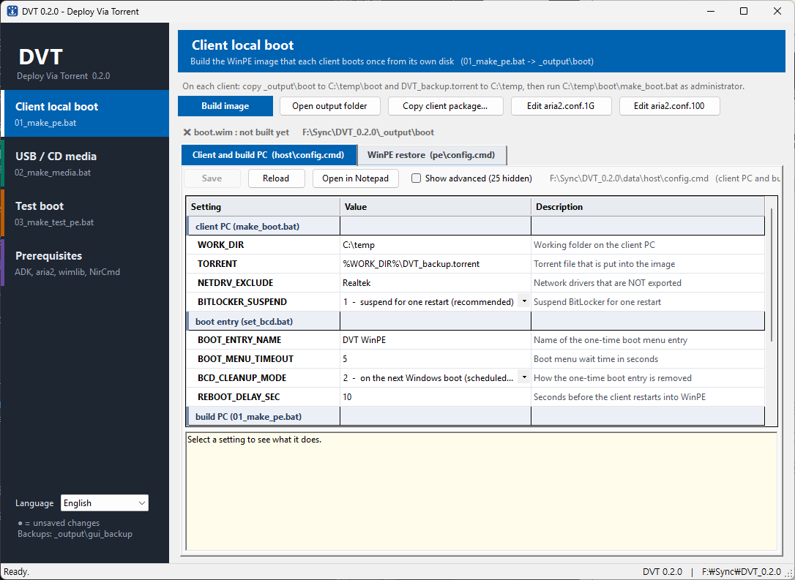

# DVT — Deploy Via Torrent

**English** | [한국어](README.ko.md)

DVT restores one Windows image to a whole room of PCs at once over the local
network. Each PC boots a small WinPE image, downloads the backup image with
BitTorrent (aria2) and applies it with wimlib. Every PC that already has a
piece also uploads it to the others, so adding PCs does not slow the
deployment down the way a single file server would.

Everything is plain Windows batch. The scripts inside WinPE use only what
WinPE ships with (no WMIC, WMI, PowerShell or findstr), plus aria2c,
wimlib-imagex and NirCmd.

> [!WARNING]
> DVT **erases a whole disk** on every PC it runs on. Test it on a spare PC
> first.

📖 **Full manual:** [doc/manual.md](doc/manual.md) ·
[PDF](doc/manual.pdf) · [한국어](doc/manual.ko.md) ·
[한국어 PDF](doc/manual.ko.pdf)

## How it works

```
Build PC      DVT_GUI.exe (or data\01_make_pe.bat)  →  _output\boot\ (boot.wim + client scripts)
Client PC     C:\temp\boot\make_boot.bat  →  one-time restart into WinPE
WinPE         checks disk, network, gateway, seeder and disk space
              → erases the disk → downloads by torrent → applies the image
              → reboots into the restored Windows
```

PCs without a working Windows can boot a **USB / CD** made by `02_make_media.bat`
instead; the operator types the IP address and the disk at each PC.

## DVT GUI

On the build PC, **DVT GUI** (`DVT_GUI.exe`) does everything in one window:
edit every setting with its description, install the Windows ADK + WinPE
add-on (choose the version), download aria2, wimlib and NirCmd, and build the
client local boot image, the USB / CD media and the test image. Build it once
with `gui_cs\build_gui.bat` (uses the C# compiler of Windows, nothing to
install). English and Korean; more languages are a text file in `lang\`.



The GUI only edits the settings files in `data\` and starts the batch files
there, so everything still works without it: run `data\01_make_pe.bat`,
`data\02_make_media.bat` or `data\03_make_test_pe.bat` and edit the
`config.cmd` files in Notepad. See [DVT GUI](doc/manual.md#dvt-gui-build-pc)
in the manual.

## Highlights

- **Torrent distribution** — restore starts the moment the download finishes,
  and the PC keeps seeding while the image is applied.
- **Nothing is erased until every check passes** — target disk, network,
  gateway, a real seeder download and the disk space. On failure the PC goes
  back to its old Windows.
- **Finds the right disk** by the disk ID read in Windows (works with
  BitLocker); a RAW-volume fallback covers PCs with instant recovery
  software. Anything ambiguous stops.
- **UEFI and BIOS**, **static IP (with DNS) or DHCP**, network drivers taken
  from the running PC, separate aria2 profiles for 100 Mbps and 1 Gbps.
- **Test image** that checks network and seeder on every PC and uploads a
  report to FTP — without touching any disk.
- **Restore record** in `HKLM\SOFTWARE\DVT` (version, image, date).

## Use it with a PC management tool such as Veyon

DVT needs two things on every client before WinPE takes over: the
`C:\temp\boot` folder with the torrent, and one run of `make_boot.bat`.
Doing that PC by PC is the slowest part of a deployment. A classroom / PC
management tool like [Veyon](https://veyon.io) (free, open source) lets you
do it for the whole room from one screen:

| DVT step | Without a management tool | With Veyon |
|---|---|---|
| Turn the PCs on | Walk to every PC | **Power on** (Wake-on-LAN) for all PCs |
| Copy `C:\temp\boot` and the torrent | USB stick at every PC | **File transfer** to all PCs, then **Run program** to put the files in `C:\temp` |
| Run `make_boot.bat` | Log in and start it on every PC | **Run program** on all PCs at once |
| Check IP and link speed | Read every monitor | `make_boot.bat` shows the IP in large digits and colors the console by link speed — visible at a glance in Veyon's **monitoring** view |
| Restart into WinPE | Press a key on every PC | **Remote control**, or **Restart** all PCs |
| Confirm the restore | Walk around again | Restored PCs show up in Veyon again (if the Veyon service is in the image) |

The same works for the **test image**: run it on the whole room first, collect
the `<ip>.txt` reports from FTP, fix the failing PCs, then deploy for real.

Things to keep in mind:

- `make_boot.bat` needs **administrator rights**. Approve the elevation prompt
  through Veyon's remote control, or run it with an account that is an
  administrator.
- Veyon puts transferred files in the user's profile folder by default; move
  them to `C:\temp` (e.g. with a small script run through **Run program**).
- While a PC is in **WinPE** the Veyon service is not running, so Veyon cannot
  show it. Read the PC's own screen, or use the test image's FTP reports.
- Put the Veyon service into the **backup image** (and, if needed, set it up
  in `setpc.bat`), so every restored PC can be managed right away.

## Quick start

1. **Build PC:** run `gui_cs\build_gui.bat` once and start `DVT_GUI.exe`.
   On *Prerequisites*, install the Windows ADK + WinPE add-on and download the
   WinPE tools; on *Client local boot*, check the settings and press
   **Build image**.
   Without the GUI: install the ADK and the add-on from Microsoft, put
   `aria2c.exe`, `wimlib-imagex.exe` (+ DLL) and `nircmd.exe` (x64) in
   `pe_tools\`, then run `data\01_make_pe.bat`.
2. **Seeder:** put `backup.wim` and a non-empty `dvt_check.txt` in a
   `DVT_backup` folder, create `DVT_backup.torrent` (V1) and seed it with
   qBittorrent's embedded tracker.
3. **Clients:** copy `_output\boot` (GUI: **Copy client package...**) to `C:\temp\boot` and the torrent to
   `C:\temp`, then run `C:\temp\boot\make_boot.bat` — by hand or with Veyon.

Details, settings and troubleshooting: [doc/manual.md](doc/manual.md).

## Requirements

- Build PC: Windows 10/11 x64, Windows ADK with the WinPE add-on (DVT GUI
  installs it); DVT GUI needs only the .NET Framework 4.x of Windows
- Clients: x64 PCs, UEFI or BIOS, wired network
- A BitTorrent tracker and at least one seeder (qBittorrent can be both; the
  setup manual is written for the qBittorrent 5.3.0 standard installer,
  libtorrent 2.1)

## Third-party tools

DVT does not include these; download them from their official sites.
[aria2](https://github.com/aria2/aria2) ·
[wimlib](https://wimlib.net/) ·
[NirCmd](https://www.nirsoft.net/utils/nircmd.html) ·
[Windows ADK](https://learn.microsoft.com/windows-hardware/get-started/adk-install) ·
optional: [qBittorrent](https://www.qbittorrent.org/),
[Veyon](https://veyon.io), [Rufus](https://rufus.ie)

## License

[BSD 3-Clause License](LICENSE) — Copyright (c) 2026, zerojinny.
DVT erases disks by design; use it at your own risk.
