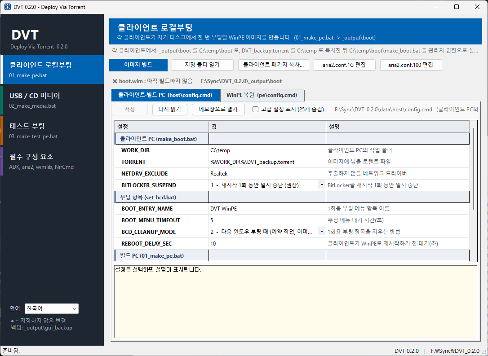
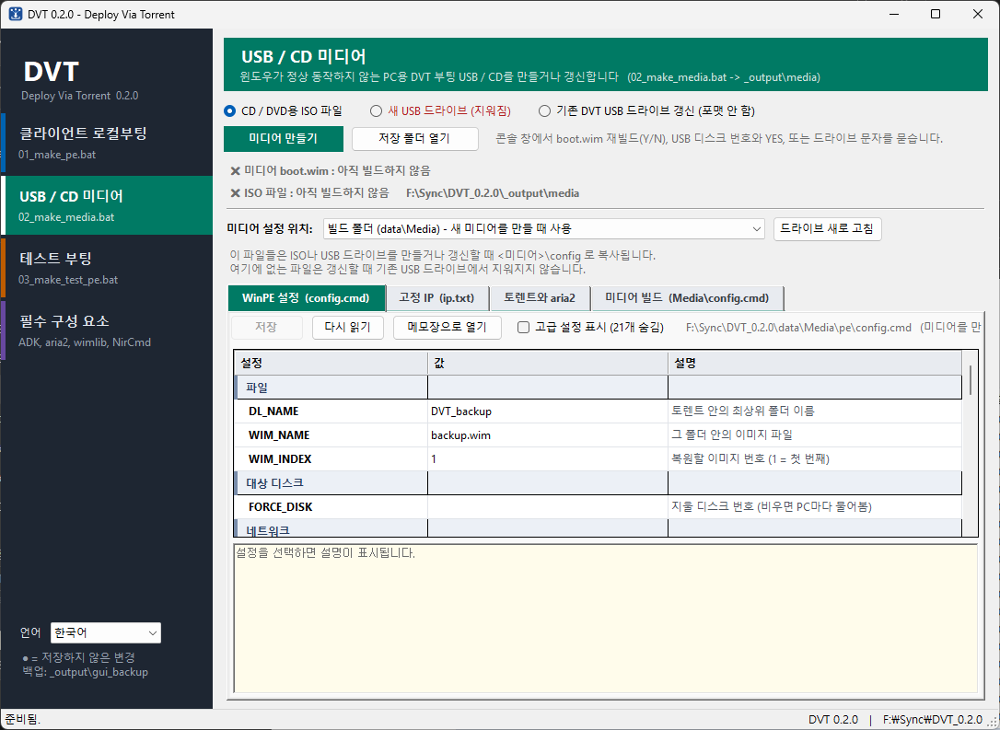
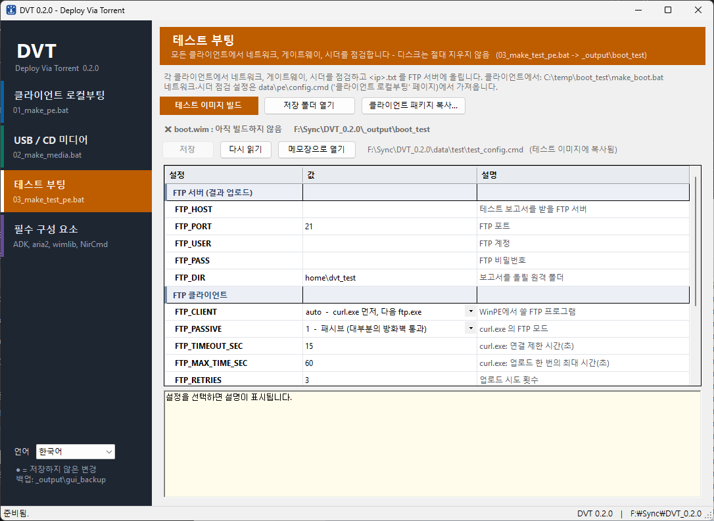
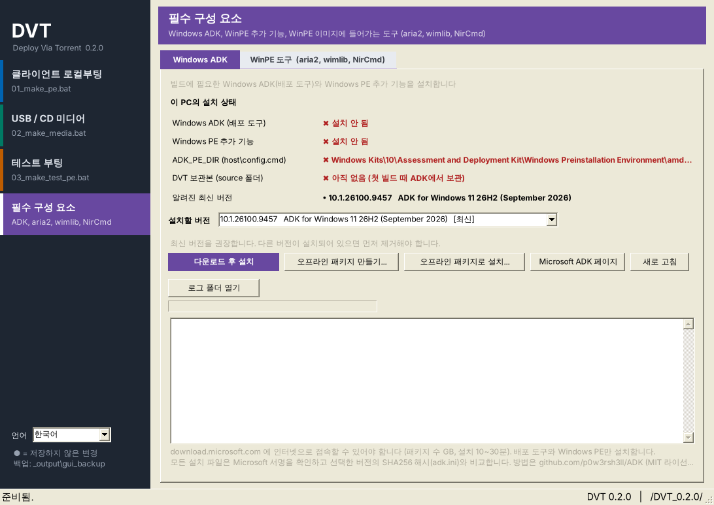
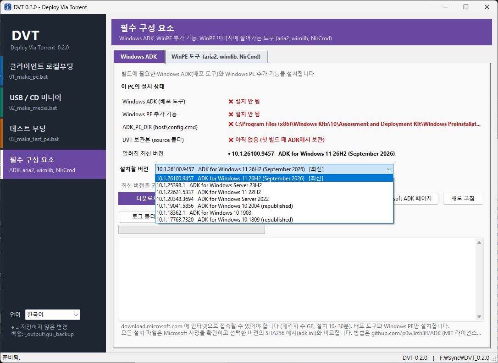

# DVT — Deploy Via Torrent 사용 설명서

[English](manual.md) | **한국어**

DVT는 로컬 네트워크에서 여러 대의 PC에 Windows 이미지를 한꺼번에 복원하는 도구입니다.
각 PC는 작은 WinPE 이미지로 부팅한 뒤, 백업 이미지를 BitTorrent(aria2)로 내려받고
wimlib로 적용합니다. 다운로드를 마친 PC는 다른 PC에게 업로드도 하기 때문에,
파일 서버 한 대로 배포할 때와 달리 PC 수가 늘어나도 배포 속도가 크게 떨어지지 않습니다.

클라이언트 PC에서 DVT를 시작하는 방법은 두 가지입니다.

- **클라이언트 로컬부팅** — 클라이언트의 Windows에서 `C:\temp\boot\make_boot.bat`을 실행하면 그 PC에
  맞게 WinPE 이미지를 준비하고 WinPE로 재시작합니다. 클라이언트 PC로 이동해 입력할 것이 없습니다.
- **USB / CD 미디어** — `02_make_media.bat`으로 부팅 USB 드라이브나 ISO를 만듭니다.
  Windows가 시작되지 않는 PC나, Windows가 설치 되어 있지 않은 PC등에서 사용합니다. 
  작업자가 PC마다 IP 주소와 디스크를 입력합니다.

빌드 PC에서는 **DVT GUI**(`DVT_GUI.exe`)로 설정을 편집하고, Windows ADK와 WinPE 도구를
설치하고, 빌드를 시작합니다. 모든 단계는 `data\`의 배치 파일을 직접 실행해서도 할 수
있습니다.

모든 스크립트는 순수 Windows 배치 파일입니다. WinPE 안에서 실행되는 스크립트는
WinPE 기본 도구만 사용하며(WMIC, WMI, PowerShell, findstr 사용 안 함),
추가로 aria2c, wimlib-imagex, NirCmd를 사용합니다.

> [!WARNING]
> DVT는 실행되는 클라이언트 PC의 **디스크 하나를 통째로 지웁니다.**
> [지울 디스크 선택](#지울-디스크-선택) 항목을 먼저 읽고, 실습실이나 사무실에서
> 사용하기 전에 여분의 PC로 반드시 테스트하세요.

---

## 목차

- [동작 방식](#동작-방식)
- [주요 기능](#주요-기능)
- [요구 사항](#요구-사항)
- [저장소 구성](#저장소-구성)
- [DVT GUI (빌드 PC)](#dvt-gui-빌드-pc)
- [빠른 시작 — 클라이언트 로컬부팅](#빠른-시작--클라이언트-로컬부팅)
- [빠른 시작 — USB / CD 미디어](#빠른-시작--usb--cd-미디어)
- [테스트 이미지](#테스트-이미지)
- [Veyon 같은 PC 관리 프로그램과 함께 쓰기](#veyon-같은-pc-관리-프로그램과-함께-쓰기)
- [토렌트 준비](#토렌트-준비)
- [qBittorrent 설정 (시더와 트래커)](#qbittorrent-설정-시더와-트래커)
- [지울 디스크 선택](#지울-디스크-선택)
- [네트워크](#네트워크)
- [USB / CD 미디어 세부 사항](#usb--cd-미디어-세부-사항)
- [설정](#설정)
- [버전](#버전)
- [스크립트 목록](#스크립트-목록)
- [문제 해결](#문제-해결)
- [제한 사항](#제한-사항)
- [외부 도구](#외부-도구)
- [라이선스](#라이선스)

---

## 동작 방식

| | 클라이언트 로컬부팅 | USB / CD 미디어 |
|---|---|---|
| 빌드 PC | `01_make_pe.bat` → `_output\boot\` 폴더 | `02_make_media.bat` → ISO 또는 USB 드라이브 |
| WinPE 전 클라이언트 PC | Windows에서 `C:\temp\boot\make_boot.bat` 실행 (PC마다 한 번) | 없음 — 미디어로 부팅 |
| WinPE 주 스크립트 | `data\pe\start_dvt.bat` | `data\Media\pe\start_media.bat` |
| IP 주소 | Windows에서 확인 (고정 IP → `ip.txt`) | `ip.txt`의 고정 IP(끝자리는 작업자 입력) 또는 DHCP, 순서는 `DHCP_ENABLE` |
| 지울 디스크 | 자동 판별 (디스크 ID, 다음으로 RAW 볼륨 대체 규칙) | 작업자가 입력 |
| 지우기 전 실패 시 | 기존 Windows로 재부팅 | 키 입력을 기다린 뒤 재부팅 |
| WinPE 설정 | `data\pe\config.cmd` (`boot.wim` 안) | `data\Media\pe\config.cmd` (미디어에도 복사, USB에서 수정 가능) |

두 방법 모두 무엇이든 지우기 **전에** 게이트웨이, 시더, 디스크 공간을 확인하며, 같은
토렌트, aria2 프로필, 다운로드, 복원(`restore.bat`, `setpc.bat`)을 사용합니다. 두
방법이 함께 쓰는 WinPE 스크립트는 `data\common`에 한 벌만 둡니다.

### 클라이언트 로컬부팅

```
[1] 빌드 PC ── 01_make_pe.bat
      ADK winpe.wim + DVT 스크립트 + aria2c, wimlib
      → _output\boot\ 폴더 (boot.wim, boot.sdi, host 스크립트)
         │
         │  _output\boot\ 폴더 → 클라이언트의 C:\temp\boot 로 복사
         ▼
[2] 클라이언트 PC (Windows) ── C:\temp\boot\make_boot.bat
      • IP 주소(와 고정 DNS), 링크 속도 확인
      • Windows 디스크의 디스크 ID 확인
      • 네트워크 드라이버 추출
      • boot.wim에 드라이버, ip.txt, 토렌트, aria2.conf,
        target_disk.txt 추가
      • BitLocker를 재시작 1회 동안 일시 중단 (켜져 있을 때)
      • 1회용 부팅 항목 추가
         │
         │  재부팅
         ▼
[3] 클라이언트 PC (WinPE) ── start_dvt.bat
      • 대상 디스크 확인 (디스크 ID, 다음으로 대체 규칙)
      • 네트워크 설정
      • 게이트웨이·시더 확인
      • 디스크 공간 확인             ← 여기까지 실패하면 디스크를 건드리지 않고
                                       기존 Windows로 재부팅
      • 디스크 삭제, 파티션 생성
      • 토렌트 다운로드 (aria2c)
         │
         │  다운로드 완료 (aria2c는 계속 시딩)
         ▼
    restore.bat
      • WIM 적용, 드라이버, bcdboot, setpc.bat
      • HKLM\SOFTWARE\DVT에 버전과 이미지 기록
         │
         ▼
    복원된 Windows로 재부팅
```

### USB / CD 미디어

```
[1] 빌드 PC ── 02_make_media.bat
      source\winpe.wim (ADK 원본 사본)
      + pe_tools, drivers, nircmd
      + data\Media\pe, data\common  (이 스크립트만 사용)
      → _output\media\boot.wim
      + source\adk_media, data\Media\config, data\Media\pe\config.cmd
      → ISO (oscdimg) 또는 USB 드라이브
         │
         │  USB / CD로 부팅
         ▼
[2] 클라이언트 PC (WinPE) ── startnet.cmd
      • <미디어>\config\* → X:\restore 복사
         ▼
    start_media.bat
      • 네트워크 순서 결정 (DHCP_ENABLE: 고정 IP 우선 / DHCP 우선)
      • 디스크 목록 표시, "150.0" 입력 (IP 끝자리.디스크 번호)
      • 게이트웨이 확인
      • link.exe → 링크 속도별 aria2.conf
      • 시더 확인
      • 디스크 공간 확인            ← 여기까지 실패하면 아무것도 지우지 않음
      • 디스크 삭제, 파티션 생성
      • 다운로드 드라이브 선택, 토렌트 다운로드 (aria2c)
         │
         │  다운로드 완료 (aria2c는 계속 시딩)
         ▼
    restore.bat
      • WIM 적용, 드라이버, bcdboot
      • 파일 이동, setpc.bat, HKLM\SOFTWARE\DVT에 기록
         │
         ▼
    재부팅 (USB / CD를 빼세요)
```

미디어 이미지는 `_output\boot\boot.wim`이나 `data\pe` 폴더를 **사용하지 않습니다**.
`X:\restore`에는 `pe_tools`의 도구와 `data\Media\pe`, `data\common`의 파일만 들어갑니다.

## 주요 기능

- **BitTorrent 배포**: aria2c를 사용하며, 다운로드가 끝나는 즉시 복원을 시작하고
  이미지를 적용하는 동안에도 계속 시딩합니다.
- **삭제 전 안전 점검**: 대상 디스크, 네트워크, 게이트웨이, 시더로부터의 실제
  다운로드, 디스크 공간을 먼저 확인합니다. 하나라도 실패하면 아무것도 지우지 않습니다.
- **대상 디스크 자동 판별**: 실행 중인 Windows에서 읽은 디스크 ID(GPT 디스크 GUID /
  MBR 서명)로 찾으며, 직접 지정과 순간복구 프로그램을 위한 신중한 대체 규칙도
  제공합니다. 조금이라도 애매하면 오류로 처리합니다. USB / CD
  미디어에서는 작업자가 디스크를 고르며, 부팅 미디어는 고를 수 없습니다.
- **BitLocker 대응**: 디스크 ID는 암호화된 Windows 드라이브에서도 동작하며,
  보호를 재시작 1회 동안 일시 중단하므로 점검이 실패해 Windows로 돌아가도 복구 키를
  묻지 않습니다.
- **UEFI와 레거시 BIOS 지원**: GPT/MBR 구성과 `bcdboot` 펌웨어 유형을 자동으로
  선택합니다. ISO와 USB 드라이브도 둘 다에서 부팅됩니다.
- **고정 IP 또는 DHCP**: Windows에서 쓰던 고정 IP(고정 DNS 포함)를 WinPE로 가져와,
  게이트웨이에 연결되는 어댑터에 적용합니다. 미디어는 고정 IP와 DHCP 중 하나를
  먼저 시도하고(`DHCP_ENABLE`) 실패하면 다른 쪽을 사용합니다.
- **실행 중인 PC의 네트워크 드라이버 사용**: 드라이버를 추출해 WinPE에 넣으므로,
  WinPE가 기본으로 지원하지 않는 랜카드도 동작합니다.
- **링크 속도별 프로필**: 100 Mbps와 1 Gbps 링크에 각각 다른 aria2 설정을 사용합니다.
- **복원 후 작업**: 추가 파일을 `C:\temp`로 복사하고, 선택적으로 `setpc.bat`을
  Windows 첫 시작 시 한 번 실행합니다.
- **복원 기록**: DVT 버전, 이미지, 날짜 등을 복원된 Windows의 `HKLM\SOFTWARE\DVT`에
  기록합니다([버전](#버전) 참고).
- **1회용 부팅 항목**: 사용 후 자동으로 삭제됩니다.
- **USB / CD 미디어**: Windows가 동작하지 않는 PC용. USB 드라이브라면 다시 빌드하지
  않고 설정을 바꿀 수 있습니다.
- **큰 글씨 IP 표시**: 멀리서도 어느 PC인지 알아볼 수 있습니다.

## 요구 사항

**빌드 PC**

- Windows 10/11 x64, 관리자 권한
- DVT GUI: Windows 10/11의 .NET Framework 4.x(따로 설치할 것 없음)
- [Windows ADK](https://learn.microsoft.com/windows-hardware/get-started/adk-install)와
  **Windows PE 추가 기능**(amd64). USB / CD 미디어는 ADK의 **Deployment Tools**도
  필요합니다(처음 실행할 때만, 아래 참고). DVT GUI가 둘 다 설치합니다(*필수 구성 요소* 페이지).
- `aria2c.exe`, `wimlib-imagex.exe`(DLL 포함) — `pe_tools\` 또는 `system32\`에 배치
- `nircmd.exe`(x64) — `pe_tools\`에 배치(`NIRCMD_SRC`)
- DVT GUI가 aria2, wimlib, NirCmd를 `pe_tools\`로 받아 줍니다(*필수 구성 요소* 페이지).
- USB / CD 미디어만: `data\Media\pe`의 64비트 `link.exe`. 컴파일하지 않고 그대로
  사용하며, 없으면 `02_make_media.bat`이 중단됩니다.

`02_make_media.bat`은 ADK의 `Media` 폴더를 `source\adk_media`에, oscdimg·부트 섹터
파일·bootsect를 `source\adk_tools`에 보관하고, 이후에는 보관본(과 `01_make_pe.bat`과
함께 쓰는 `source\winpe.wim`)만 사용합니다. `01_make_pe.bat`을 먼저 실행할 필요는
없습니다.

**클라이언트 PC**

- 클라이언트 로컬부팅: Windows 10/11 x64, 관리자 권한(`make_boot.bat` 실행용)
- USB / CD 미디어: USB나 CD로 부팅할 수 있는 PC (UEFI 또는 BIOS)
- 배포 네트워크에 유선으로 연결

**배포 네트워크**

- 클라이언트에서 접근 가능한 BitTorrent **트래커**. aria2 프로필에서 DHT,
  피어 교환(PEX), 로컬 피어 탐색(LPD)을 꺼 두었기 때문에 피어는 트래커로만 찾습니다.
- 완전한 `DVT_backup` 폴더를 가진 **시더**가 최소 한 대
- qBittorrent 하나로 시더와 트래커를 함께 맡을 수 있습니다.
  [qBittorrent 설정](#qbittorrent-설정-시더와-트래커)을 참고하세요.

## 저장소 구성

```
dvt/
├─ DVT_GUI.exe              DVT GUI (선택)
├─ lang/                    DVT GUI 언어 파일 (en.ini, ko.ini)
├─ qbittorrent-setup.ko.md  qBittorrent 시더·트래커 설정 매뉴얼
├─ qbittorrent-setup.en.md  같은 매뉴얼의 영어판
├─ doc/                     manual.md / manual.ko.md (README와 qBittorrent
│  │                        매뉴얼을 합친 문서)와 PDF
│  ├─ images/               DVT GUI 스크린샷 (*.en.png, *.ko.png)
│  └─ qbittorrent.ini/      qBittorrent 설정 파일: qbittorrent.ini.1G,
│                           qbittorrent.ini.100
├─ data/                    모든 스크립트와 설정
│  ├─ 01_make_pe.bat           WinPE 이미지 빌드 (빌드 PC)
│  ├─ 03_make_test_pe.bat      테스트용 WinPE 이미지 빌드 (빌드 PC)
│  ├─ 02_make_media.bat        USB / CD 미디어 빌드: ISO, 새 USB 드라이브,
│  │                           USB 드라이브 갱신 (빌드 PC)
│  ├─ adk.ini                  GUI의 ADK 릴리스 목록 (링크, 해시)
│  ├─ common/                  클라이언트 로컬부팅, 테스트 이미지, USB / CD
│  │  │                        미디어가 함께 쓰는 WinPE 스크립트
│  │  │                        (pe/ 또는 Media/pe/ 다음에 X:\restore로 복사)
│  │  ├─ version.cmd           DVT 버전 (버전을 정하는 유일한 곳)
│  │  ├─ restore.bat           이미지 적용, 부팅 파일, 기록, 정리
│  │  ├─ start_restore.bat     다운로드 완료 시 aria2c가 호출
│  │  ├─ check_space.bat       지우기 전 디스크 공간 확인
│  │  └─ ...                   check_gateway, check_seeder, get_firmware,
│  │                           get_ip, get_target, make_disk, ping_host,
│  │                           set_ip, wait (스크립트 목록 참고)
│  ├─ host/                    Windows 쪽 스크립트 (클라이언트 PC)
│  │  ├─ config.cmd            host 스크립트와 01_make_pe.bat 설정
│  │  ├─ make_boot.bat         클라이언트 PC 준비 후 WinPE로 재시작
│  │  ├─ get_host_ip.bat       IP 주소, 고정 DNS, 고정/DHCP 판별
│  │  ├─ get_link_speed.bat    링크 속도 -> aria2 프로필
│  │  ├─ get_disk_id.bat       Windows 디스크의 디스크 ID
│  │  ├─ suspend_bitlocker.bat BitLocker를 재시작 1회 동안 일시 중단
│  │  ├─ export_net_drivers.bat
│  │  ├─ prepare_mount_dir.bat
│  │  ├─ set_bcd.bat           1회용 WinPE 부팅 항목
│  │  └─ show_ip.bat           IP 주소를 큰 글씨로 표시
│  ├─ pe/                      클라이언트 로컬부팅의 WinPE 스크립트
│  │  ├─ config.cmd            WinPE 스크립트 설정
│  │  ├─ startnet.cmd          WinPE 시작 지점
│  │  ├─ start_dvt.bat         주 흐름
│  │  ├─ get_disk.bat          지울 디스크 판별 (디스크 ID, 대체 규칙)
│  │  ├─ aria2.conf.100        100 Mbps 링크용 aria2 프로필
│  │  └─ aria2.conf.1G         1 Gbps 링크용 aria2 프로필
│  ├─ Media/                   USB / CD 미디어
│  │  ├─ config.cmd            02_make_media.bat 설정 (host\config.cmd를 불러옴)
│  │  ├─ link.au3              link.exe의 소스 (참고용)
│  │  ├─ config/               <미디어>\config로 복사됨
│  │  │  ├─ DVT_backup.torrent
│  │  │  ├─ aria2.conf.100
│  │  │  ├─ aria2.conf.1G
│  │  │  ├─ ip.txt             고정 IP (ip.txt.example 참고)
│  │  │  └─ ip.txt.example
│  │  ├─ pe/                   미디어 전용 WinPE 스크립트 -> X:\restore
│  │  │  ├─ config.cmd         미디어 WinPE 스크립트 설정
│  │  │  │                     (<미디어>\config에도 복사됨)
│  │  │  ├─ startnet.cmd       미디어 찾기, config\ 복사, start_media.bat 실행
│  │  │  ├─ start_media.bat    주 흐름
│  │  │  ├─ get_input.bat      디스크 목록, IP 끝자리와 디스크 번호 입력
│  │  │  ├─ getdiskinfo.bat    디스크 목록
│  │  │  └─ link.exe           링크 속도별 aria2.conf 선택 (64비트, 필수)
│  └─ test/                    테스트 이미지 스크립트 (테스트 이미지 참고)
│     ├─ test_config.cmd       FTP 서버와 테스트 설정
│     ├─ startnet.cmd          테스트 WinPE 시작 지점
│     ├─ start_test.bat        테스트 흐름: 네트워크, 게이트웨이, 시더, 업로드
│     └─ upload_ftp.bat        FTP 업로드 (curl.exe 또는 ftp.exe)
│
│  ── 저장소에 포함되지 않음, 직접 준비 ──
├─ pe_tools/                aria2c.exe, wimlib-imagex.exe, DLL, nircmd.exe -> X:\restore
├─ system32/                선택 사항, X:\Windows\System32로 복사
├─ drivers/                 선택 사항, 모든 WinPE 이미지에 추가할 드라이버
│
│  ── 빌드 스크립트가 생성 ──
├─ source/                  ADK 파일 보관본 (처음 실행할 때만 복사)
│  ├─ winpe.wim, boot.sdi   원본 사본 (01_make_pe.bat, 02_make_media.bat)
│  ├─ adk_media/            ADK WinPE "Media" 폴더 (02_make_media.bat)
│  └─ adk_tools/            oscdimg.exe, etfsboot.com, bootsect.exe,
│                           efisys.bin (= ADK efisys_noprompt.bin 이름 변경)
└─ _output/                 빌드 결과물
   ├─ boot/                 01_make_pe.bat 결과: boot.wim + boot.sdi + host 스크립트
   │                        + version.cmd
   │                        (클라이언트의 C:\temp\boot로 복사)
   ├─ boot_test/            03_make_test_pe.bat 결과 (클라이언트의 C:\temp\boot_test로 복사)
   └─ media/                02_make_media.bat 결과: 미디어용 boot.wim, DVT_media.iso
```

## DVT GUI (빌드 PC)

빌드 PC에서 하는 일은 모두 **DVT GUI**(`DVT_GUI.exe`)에서 할 수 있습니다. 설정을
편집하고, 필수 구성 요소를 설치하고, 빌드를 시작합니다. GUI는 `data\`의 설정 파일을
고치고 `data\`의 배치 파일을 실행할 뿐이므로, 모든 단계를 GUI 없이도 할 수 있습니다.
배치 파일을 직접 실행하고 `config.cmd` 파일을 메모장으로 고치면 됩니다
([GUI 없이 사용](#gui-없이-사용) 참고).

### 실행

1. `DVT_GUI.exe`는 빌드 폴더(`data\`가 있는 폴더)에 둡니다. Windows 10/11에 들어 있는
   .NET Framework 4.x 외에는 필요한 것이 없습니다.
2. `DVT_GUI.exe`를 더블클릭합니다. 관리자 권한은 필요 없습니다. 각 빌드는 자기
   콘솔 창에서 관리자 권한을 요청하고, 스크립트의 질문(재빌드 Y/N, USB 디스크 번호,
   `YES`, 드라이브 문자)도 그 창에서 답합니다.

### 페이지

왼쪽 사이드바로 네 페이지를 전환합니다. 페이지마다 색이 다르며, 저장하지 않은
변경은 사이드바의 점과 탭의 `●`로 표시됩니다.

| 페이지 | 실행 | 편집하는 설정 |
|---|---|---|
| **클라이언트 로컬부팅** | `data\01_make_pe.bat` | `data\host\config.cmd`, `data\pe\config.cmd`, aria2 프로필 |
| **USB / CD 미디어** | `data\02_make_media.bat iso` / `usb` / `update` | `data\Media\pe\config.cmd`, `ip.txt`, 토렌트, aria2 프로필, `data\Media\config.cmd` |
| **테스트 부팅** | `data\03_make_test_pe.bat` | `data\test\test_config.cmd` |
| **필수 구성 요소** | Windows ADK 설치, 도구 다운로드 | — |



- **설정 표:** 모든 설정에 짧은 설명이 있고, 줄을 선택하면 표 아래에 자세한
  도움말(기능, 선택지, 파일의 주석)이 나옵니다. 선택지가 정해진 설정은 드롭다운으로
  고릅니다. 보통 바꾸지 않는 설정(경로, 도구 위치, 색 등)은 **고급 설정 표시**를
  체크해야 보입니다.
- **저장**은 바뀐 `set "NAME=VALUE"` 줄만 고치고 주석은 그대로 둡니다. 저장하기 전에
  이전 파일을 `_output\gui_backup\`에 복사합니다. **다시 읽기**는 파일을 다시 읽고,
  **메모장으로 열기**는 직접 편집할 때 씁니다.
- **이미지 빌드**는 `01_make_pe.bat`을 실행합니다(저장하지 않은 변경이 있으면 먼저
  저장할지 묻습니다). 버튼 아래 줄에 `boot.wim`의 빌드 여부가 표시됩니다.
- **클라이언트 패키지 복사...** 는 `_output\boot`를 고른 폴더(USB 메모리, 공유
  폴더 등)로 복사합니다. 이것을 클라이언트의 `C:\temp\boot`로 복사하면 됩니다.



- **CD / DVD용 ISO 파일**, **새 USB 드라이브 (지워짐)**, **기존 DVT USB 드라이브 갱신
  (포맷 안 함)** 중 하나를 고르고 **미디어 만들기**를 누릅니다.
- **미디어 설정 위치:** 빌드 폴더(`data\Media`, 새 미디어를 만들 때 사용) 또는 기존
  DVT USB 드라이브. USB 드라이브를 고르면 WinPE 설정, `ip.txt`, 토렌트를
  `<USB>:\config`에서 직접 읽고 씁니다. 다시 빌드하지 않아도 다음 부팅부터 적용됩니다.
- 탭: **WinPE 설정**, **고정 IP (ip.txt)**(PC마다 한 줄, 저장 전에 검사),
  **토렌트와 aria2**, **미디어 빌드**.



- FTP 서버(`FTP_HOST`, `FTP_USER`, `FTP_PASS` 등)를 설정하고 **테스트 이미지 빌드**를
  누릅니다. 네트워크·시더 점검 설정은 `data\pe\config.cmd`(*클라이언트 로컬부팅*
  페이지)를 따릅니다.

### 필수 구성 요소



**Windows ADK** 탭은 DVT에 필요한 것만 설치합니다. Windows ADK의 **배포 도구**와
**Windows PE 추가 기능**입니다. 현재 설치 상태도 보여 줍니다.

- **설치할 버전:** `data\adk.ini`의 ADK 릴리스입니다. Windows 10 1809
  (10.1.17763.7320)부터 최신(기본값)까지 있고, 설치된 버전이 표시됩니다. 다른 버전이
  설치되어 있으면 *설치된 ADK와 WinPE 추가 기능을 먼저 제거*가 체크됩니다(ADK
  설치 프로그램은 다른 버전을 덮어쓰지 못함, 오류 2008).
- **다운로드 후 설치:** 선택한 릴리스의 `adksetup.exe`와 `adkwinpesetup.exe`를
  Microsoft에서 받아, Microsoft 서명과 그 릴리스의 SHA256을 확인한 뒤 관리자 권한을
  한 번 물어 조용히 설치합니다. 설치 프로그램이 수 GB를 내려받으며 10~30분 걸립니다.
  로그: `_output\adk_setup\`.
- **오프라인 패키지 만들기...** / **오프라인 패키지로 설치...** 는 인터넷이 안 되는
  빌드 PC용입니다.
- 새 릴리스는 `data\adk.ini`에 `[release <버전>]` 구역(링크, 해시)을 추가합니다.
  GUI를 다음에 시작할 때부터 적용됩니다.



**WinPE 도구** 탭은 aria2, wimlib, NirCmd(x64)를 공식 사이트에서 받아 zip의 SHA256을
알려진 해시와 비교한 뒤 `pe_tools\`(`PE_TOOLS_DIR`)로 복사합니다. 바뀌는 파일은
`_output\tools_backup\`에 먼저 백업합니다.

### 언어

GUI의 모든 문구는 `lang\en.ini`, `lang\ko.ini`에 있습니다. 언어는 사이드바 아래에서
고르며, 선택은 `data\gui_settings.ini`에 저장됩니다. 언어 파일은 `DVT_GUI.exe` 옆의 `lang\`을 먼저 찾고, 없으면 exe에 내장된
파일을 쓰므로 파일만 고치면 문구가 바뀝니다. 새 언어는 `en.ini`를 복사해 번역하면
다음 실행 때 목록에 나타납니다.

### GUI 없이 사용

| GUI에서 | GUI 없이 |
|---|---|
| 설정 편집, **저장** | `data\`의 `config.cmd` 파일을 메모장으로 수정 |
| **이미지 빌드** | `data\01_make_pe.bat` 실행 |
| **미디어 만들기** | `data\02_make_media.bat` 실행(메뉴), 또는 `02_make_media.bat iso` / `usb` / `update` |
| **테스트 이미지 빌드** | `data\03_make_test_pe.bat` 실행 |
| **클라이언트 패키지 복사...** | `_output\boot`(또는 `_output\boot_test`)를 직접 복사 |
| **Windows ADK** | [Microsoft 페이지](https://learn.microsoft.com/windows-hardware/get-started/adk-install)에서 ADK(배포 도구)와 WinPE 추가 기능 설치 |
| **WinPE 도구** | 도구를 받아 `pe_tools\`에 넣기 |

배치 파일은 스스로 관리자 권한을 요청합니다.

## 빠른 시작 — 클라이언트 로컬부팅

### 1. WinPE 이미지 빌드 (빌드 PC)

1. `DVT_GUI.exe`를 시작합니다([DVT GUI](#dvt-gui-빌드-pc) 참고).
2. *필수 구성 요소* → **Windows ADK**: 버전을 고르고 **다운로드 후 설치**를 누릅니다.
   GUI 없이: Microsoft에서 Windows ADK(배포 도구)와 WinPE 추가 기능을 설치합니다.
3. *필수 구성 요소* → **WinPE 도구**: **없는 도구 다운로드**를 누릅니다.
   GUI 없이: `aria2c.exe`, `wimlib-imagex.exe`와 DLL, `nircmd.exe`(x64)를 `pe_tools\`에
   넣습니다.
4. 필요하면 `drivers\`에 드라이버를 넣습니다(예: 신형 하드웨어용 스토리지 드라이버,
   [Realtek 랜카드](#realtek-랜카드)용 WinPE 드라이버).
5. *클라이언트 로컬부팅*: 두 탭의 설정(`data\host\config.cmd`, `data\pe\config.cmd`,
   [설정](#설정) 참고)을 확인하고 **저장**합니다.
6. **이미지 빌드**를 누릅니다. GUI 없이: `data\01_make_pe.bat`을 실행합니다. 필요하면
   관리자 권한을 요청합니다.

결과물은 `_output\boot\` 폴더입니다. 이 폴더에는 `boot.wim`, `boot.sdi`, `data\host\`의
모든 파일, `version.cmd`가 복사되어 있어, 토렌트를 제외하면 클라이언트 PC에 필요한 것이 모두 들어 있습니다.

> 마운트 폴더와 작업 폴더는 로컬 시스템 드라이브(`C:\WinPE_LocalBuild`)에 있습니다.
> OneDrive, Dropbox 등으로 동기화되는 폴더로 옮기지 마세요. 동기화 프로그램이
> 마운트 해제 후 삭제된 파일을 되살릴 수 있습니다.

### 2. 토렌트와 시더 준비

[토렌트 준비](#토렌트-준비)를 참고하세요. 트래커와 시더를 실행해 둡니다
(qBittorrent를 쓴다면 [qBittorrent 설정](#qbittorrent-설정-시더와-트래커) 참고).

### 3. 각 클라이언트 PC 준비

빌드 PC의 `_output\boot\` 폴더를 클라이언트의 `C:\temp\boot`로, 토렌트를 `C:\temp`로 복사합니다.
GUI의 **클라이언트 패키지 복사...** 로 `_output\boot`를 먼저 USB 메모리나 공유 폴더에 복사할 수 있습니다.

```
C:\temp\
├─ boot\
│  ├─ boot.wim
│  ├─ boot.sdi
│  ├─ make_boot.bat
│  ├─ config.cmd
│  └─ ...             (나머지 host 스크립트)
└─ DVT_backup.torrent
```

`C:\temp\boot\make_boot.bat`을 실행하면 다음 작업을 합니다.

1. IP 주소를 확인합니다(고정 IP이면 ip, 서브넷, 게이트웨이, 고정 DNS를 한 줄에
   하나씩 `ip.txt`에 저장).
2. 링크 속도를 읽어 `aria2.conf.100` 또는 `aria2.conf.1G`를 고릅니다.
3. Windows 디스크의 디스크 ID를 읽습니다.
4. 연결된 네트워크 어댑터의 드라이버를 추출합니다.
5. `boot.wim`을 마운트하고 드라이버, `ip.txt`, 토렌트, `aria2.conf`,
   `target_disk.txt`(디스크 ID)를 넣습니다.
6. Windows 드라이브에 BitLocker가 켜져 있으면 재시작 1회 동안 일시 중단합니다.
7. 1회용 WinPE 부팅 항목을 추가합니다.
8. IP 주소를 큰 글씨로 보여 주고, 키를 누르면 재시작합니다.

### 4. 진행 확인

PC가 WinPE로 부팅해 스스로 복원합니다. 콘솔 색으로 상태를 알 수 있습니다.

| 콘솔 | 의미 |
|---|---|
| 밝은 회색 배경 | 점검, 파티션 생성, 다운로드 중 |
| 녹색 배경 (새 "DVT Restore" 창) | 복원 진행 중, 이어서 완료 후 재부팅 |
| 빨간색 배경 | 실패 — 화면의 메시지를 확인하세요 |

디스크를 지우기 **전에** 점검이 실패하면 몇 초 뒤 기존 Windows로 다시 부팅합니다.
디스크를 지운 **후에** 문제가 생기면 오류를 읽을 수 있도록 키 입력을 기다립니다.

## 빠른 시작 — USB / CD 미디어

1. 토렌트와 시더를 준비합니다([토렌트 준비](#토렌트-준비),
   [qBittorrent 설정](#qbittorrent-설정-시더와-트래커) 참고).
2. DVT GUI의 *USB / CD 미디어* 페이지에서 **토렌트와 aria2** 탭으로 토렌트를 고르고,
   **고정 IP (ip.txt)** 탭에 고정 IP를 입력합니다([네트워크](#네트워크) 참고).
   GUI 없이: `data\Media\config`에 `DVT_backup.torrent`, `aria2.conf.100`,
   `aria2.conf.1G`, `ip.txt`를 넣습니다.
3. **WinPE 설정** 탭(`data\Media\pe\config.cmd`, [설정](#설정) 참고)을 확인하고 저장합니다.
4. ISO, 새 USB 드라이브, 갱신 중 하나를 고르고 **미디어 만들기**를 누릅니다. 또는
   `data\02_make_media.bat`을 관리자 권한으로 실행하고 선택합니다.
   - `1` ISO → `_output\media\DVT_media.iso`, CD / DVD로 굽기
   - `2` USB → 선택한 **USB** 디스크를 지우고 부팅 가능하게 만듦
     (디스크 전체를 FAT32로, `data\Media\config.cmd`의 `USB_FS`, `USB_PART_MB`)
   - `3` 갱신 → 기존 DVT USB 드라이브에 새 파일 복사

   `02_make_media.bat iso`, `02_make_media.bat usb`, `02_make_media.bat update`로 메뉴를
   건너뛸 수 있습니다.
5. 클라이언트 PC를 미디어로 부팅하고 디스크 목록을 확인한 뒤, 고정 IP라면
   `<IP 끝자리>.<디스크>`(예: `150.0`), DHCP라면 디스크 번호만 입력하고 `Y`를
   누릅니다.
6. 복원이 끝나면 15초 후 재부팅합니다 — 미디어를 빼세요.

> [!WARNING]
> 입력한 번호의 디스크는 **지워집니다**. 디스크 목록을 잘 확인하세요. 부팅에
> 사용한 USB 드라이브의 디스크는 선택할 수 없습니다.

작업자가 있으므로 미디어에서는 실패하면 항상 키 입력을 기다립니다.

## 테스트 이미지

`03_make_test_pe.bat`은 디스크를 전혀 건드리지 않고 클라이언트 PC를 처음부터 끝까지
점검하는 **테스트용** WinPE 이미지를 만듭니다. 실제 복원 전에 네트워크, 드라이버,
시더 문제를 찾는 데 사용합니다. 클라이언트 로컬부팅과 같은 방법(`make_boot.bat`)으로
시작합니다.

테스트 이미지는 WinPE에서 다음을 수행합니다.

1. 복원 이미지와 똑같이 네트워크를 설정(`ip.txt`가 있으면 고정 IP, 없으면 DHCP)하고
   게이트웨이를 확인합니다.
2. 시더 점검(`dvt_check.txt`만 메모리로 다운로드)과 디스크 공간 점검(보고만 하며
   테스트를 멈추지 않음)을 합니다.
3. 보고서 `<ip>.txt`를 만듭니다(DVT 버전, IP, 게이트웨이, 어댑터, 링크 프로필, 시더,
   펌웨어, 감지된 대상 디스크와 판별 방법, 디스크 공간, 모델, `diskpart list disk`,
   대상 디스크의 `detail disk`, `ipconfig /all`).
4. FTP 서버에 업로드한 뒤 Windows로 재부팅합니다.

디스크를 지우거나 복원하는 스크립트(`make_disk.bat`, `restore.bat`,
`start_restore.bat`, `start_dvt.bat`)는 테스트 이미지에 **복사되지 않습니다**.

사용 순서:

1. DVT GUI의 *테스트 부팅* 페이지(또는 `data\test\test_config.cmd`)에서 FTP 서버를 설정합니다:
   `FTP_HOST`, `FTP_PORT`, `FTP_USER`, `FTP_PASS`, 필요하면 `FTP_DIR`
   (로그인 폴더 기준 상대 경로). 값에 `!`와 `"`는 쓸 수 없습니다.
2. **테스트 이미지 빌드**를 누르거나, 빌드 PC에서 `data\03_make_test_pe.bat`을 실행합니다. 결과물은 `_output\boot_test\` 폴더입니다.
3. 클라이언트에서 `_output\boot_test\`를 `C:\temp\boot_test`로 복사하고, 토렌트를 `C:\temp`에 둔 뒤
   `C:\temp\boot_test\make_boot.bat`을 실행합니다. `make_boot.bat`은 항상 자기 폴더의 `boot.wim`을
   사용하므로 `C:\temp\boot`와 `C:\temp\boot_test`를 클라이언트에 함께 둘 수 있습니다.

| 화면 | 의미 |
|---|---|
| 녹색 "PASS" | 게이트웨이·시더 정상, `<ip>.txt` 업로드 완료, 재부팅 |
| 빨간색 "TEST FAILED" | 점검 또는 업로드 실패. `FAIL_REBOOT_SEC` 후 재부팅(`TEST_FAIL_REBOOT=1`, 기본값). `TEST_FAIL_REBOOT=0`이면 키 입력 대기 |

`TEST_UPLOAD_FAIL=1`이면 IP가 설정된 경우 실패 시에도 `<ip>_FAIL.txt`를 업로드합니다.
FTP 클라이언트는 `curl.exe`(패시브 모드, `FTP_DIR` 자동 생성)를 우선 쓰고, 없으면
`ftp.exe`(액티브 모드만 지원, `FTP_DIR`이 미리 있어야 함)를 씁니다. WinPE에는 둘 다
없으므로 `pe_tools\`나 `system32\`에 넣지 않으면 `03_make_test_pe.bat`이 빌드 PC에서
복사합니다. FTP 설정은 이미지 안에 들어가므로 바꾼 뒤에는 다시 빌드해야 합니다.

## Veyon 같은 PC 관리 프로그램과 함께 쓰기

WinPE로 넘어가기 전에 DVT가 각 클라이언트에 필요로 하는 것은 두 가지입니다.
토렌트와 함께 둔 `C:\temp\boot` 폴더, 그리고 `make_boot.bat` 한 번 실행. 이 일을
PC마다 직접 하는 것이 배포에서 가장 시간이 많이 드는 부분입니다.
[Veyon](https://veyon.io)(무료, 오픈 소스) 같은 실습실·PC 관리 프로그램을 쓰면 한
화면에서 실습실 전체를 처리할 수 있습니다.

| DVT 단계 | 관리 프로그램 없이 | Veyon과 함께 |
|---|---|---|
| PC 켜기 | PC마다 가서 전원 켜기 | 모든 PC를 **전원 켜기**(Wake-on-LAN) |
| `C:\temp\boot`와 토렌트 복사 | PC마다 USB로 복사 | 모든 PC에 **파일 전송** 후 **프로그램 실행**으로 `C:\temp`에 배치 |
| `make_boot.bat` 실행 | PC마다 로그인해서 실행 | 모든 PC에서 **프로그램 실행**을 한 번에 |
| IP와 링크 속도 확인 | 모니터를 하나씩 확인 | `make_boot.bat`이 IP를 큰 글씨로, 링크 속도를 콘솔 색으로 보여 주므로 Veyon **모니터링** 화면에서 한눈에 확인 |
| WinPE로 재시작 | PC마다 키 누르기 | **원격 제어**로 키 입력, 또는 모든 PC **재시작** |
| 복원 완료 확인 | 다시 한 바퀴 돌기 | 복원된 PC가 Veyon에 다시 나타남(이미지에 Veyon 서비스가 있을 때) |

**테스트 이미지**에도 똑같이 쓸 수 있습니다. 먼저 실습실 전체에서 테스트 이미지를
돌려 FTP로 `<ip>.txt` 보고서를 모으고, 실패한 PC를 고친 뒤 실제 배포를 하세요.

주의할 점:

- `make_boot.bat`은 **관리자 권한**이 필요합니다. 권한 상승 창을 Veyon 원격 제어로
  승인하거나, 관리자 계정으로 실행하세요.
- Veyon은 전송한 파일을 기본적으로 사용자 프로필 폴더에 저장합니다. **프로그램
  실행**으로 작은 스크립트를 돌리는 등의 방법으로 `C:\temp`로 옮기세요.
- PC가 **WinPE**에 있는 동안에는 Veyon 서비스가 실행되지 않아 Veyon에서 보이지
  않습니다. PC 화면을 직접 보거나 테스트 이미지의 FTP 보고서를 활용하세요.
- **백업 이미지**에 Veyon 서비스를 포함해 두면(필요하면 `setpc.bat`에서 설정)
  복원된 PC를 바로 관리할 수 있습니다.

## 토렌트 준비

토렌트에는 `DVT_backup`(`DL_NAME`)이라는 최상위 폴더 하나만 있어야 합니다.

```
DVT_backup\
├─ backup.wim        Windows 이미지 (WIM_INDEX 인덱스, 기본 1)     필수
├─ dvt_check.txt     시더 점검용 작은 파일 (수 KB)                 필수
├─ drivers\          복원된 Windows에 추가할 드라이버              선택
└─ files\            복원된 Windows의 C:\temp로 복사               선택
   └─ setpc.bat      Windows 첫 시작 시 한 번 실행                 선택
```

- `dvt_check.txt`는 토렌트를 만들기 **전에** 넣어야 합니다. WinPE는 무엇이든 지우기
  전에 이 파일만 내려받아 시더에 연결되는지 확인합니다.
- 토렌트에 트래커 URL을 넣습니다. 또는 `data\pe\config.cmd`나 `data\Media\pe\config.cmd`에서
  `SEEDER_EXTRA_OPTS=--bt-tracker=http://...`를 지정할 수 있습니다(이 값은 시더 점검에만
  쓰이며, 본 다운로드는 토렌트와 `aria2.conf`의 설정을 따릅니다).
- 토렌트 파일 이름은 `DVT_backup.torrent`로 저장합니다. 클라이언트 로컬부팅은 각 클라이언트의
  `C:\temp`에, 미디어는 `data\Media\config`에 둡니다.
- `backup.wim`에 이미지가 여러 개 있으면 `data\pe\config.cmd`와
  `data\Media\pe\config.cmd`의 `WIM_INDEX`로 적용할 이미지를 고릅니다(기본값 `1`).
  이미지 목록은 `wimlib-imagex info backup.wim`으로 확인합니다. 없는 인덱스를 지정하면
  이미지를 적용하기 전에 메시지와 함께 중단합니다.
- 클라이언트가 고정 IP를 쓰면 `ip.txt`(ip, 서브넷, 게이트웨이, 알 수 있으면 DNS)도
  복원된 Windows의 `C:\temp`로 복사되므로, `setpc.bat`에서 주소를 다시 설정할 수
  있습니다.

> [!WARNING]
> `dvt_check.txt`는 **비어 있는 0바이트 파일이면 안 됩니다.** 받을 데이터가
> 없으므로 aria2c는 시더에 연결되지 않아도 다운로드를 "완료"하고, 점검이 의미가
> 없어집니다. 그래서 `check_seeder.bat`은 토렌트 안의 `dvt_check.txt`가 0바이트이면
> 디스크를 지우기 전에 점검을 실패로 처리합니다("The seeder check file in the
> torrent is empty"). 반드시 내용이 있는 파일(수 KB)을 넣고 토렌트를 만드세요.
> 파일을 바꿨다면 토렌트도 다시 만들어야 합니다.

## qBittorrent 설정 (시더와 트래커)

qBittorrent PC 한 대가 이미지를 제공하는 시더와 피어 목록을 중개하는 내장 트래커를
동시에 맡을 수 있습니다. 설정은 100Mbps 이하 네트워크와 1Gbps 이상 네트워크에서
다르며, 각각 필수 항목과 권장 항목으로 나뉩니다.

> [!IMPORTANT]
> 이 매뉴얼은 **qBittorrent 5.3.0 일반 설치 파일**(`qbittorrent_5.3.0_x64_setup.exe`,
> libtorrent 2.1) 기준입니다. 5.3.0부터 일반 설치 파일은 libtorrent 2.1.x를 기반으로
> 합니다. lt12 설치 파일(`qbittorrent_5.3.0_lt12_x64_setup.exe`)은 libtorrent 1.2로
> 빌드되어 일부 항목이 다릅니다.
> [lt12 빌드(libtorrent 1.2)와의 차이](#lt12-빌드libtorrent-12와의-차이)를 참고하세요.

> [!NOTE]
> qBittorrent 5.3.0 릴리스 노트에 따르면 libtorrent 2.1 백엔드는 1.2보다 읽기 성능이
> 낮아, 업로드가 많은 시더에서는 업로드 속도가 떨어질 수 있습니다. **1Gbps 이상
> 환경** 설정을 적용한 뒤에도 시더가 링크 속도를 채우지 못하면 lt12 빌드를 사용해
> 보세요.

### 개요

DVT에서 qBittorrent는 배포 PC 한 대에서 **시더(원본 이미지 제공)** 와 **내장 트래커(피어 목록 중개)** 를 동시에 맡고, WinPE로 부팅한 클라이언트는 aria2로 이미지를 받으면서 서로 조각을 주고받습니다.

- 100Mbps 이하 환경은 **네트워크 대역폭**이 병목입니다. 시더 업로드를 아끼고 클라이언트끼리 조각을 나누게 만드는 것이 핵심입니다.
- 1Gbps 이상 환경은 **시더의 디스크·CPU·소켓 버퍼**가 병목입니다. 버퍼와 I/O 스레드를 늘려 회선을 채우는 것이 핵심입니다.

사용 순서: **공통 설정**을 먼저 적용하고, **환경 판단 기준**으로 환경을 판단한 뒤 **100Mbps 이하 환경** 또는 **1Gbps 이상 환경**의 값을 덮어씁니다. 메뉴와 항목 이름은 qBittorrent 5.3.0의 **한국어 UI** 기준입니다. 설정 창은 **도구 → 옵션**, 토렌트 만들기는 **도구 → 토렌트 생성기**에 있으며, 버전에 따라 번역이 조금 다를 수 있습니다. 영어 UI를 쓰는 경우 영문판 매뉴얼([manual.md](manual.md))을 참고하세요. 옵션을 하나씩 바꾸는 대신 [미리 만든 설정 파일](#미리-만든-설정-파일qbittorrentini-사용하기)로 교체할 수도 있습니다.

### 공통 설정 (두 환경 모두 적용)

필수 항목은 빠지면 배포가 실패하거나 멈추는 설정이고, 권장 항목은 안정성과 보안을 높이는 설정입니다. 핵심은 내장 트래커를 켜고, 프로토콜을 TCP로 고정하고, 토렌트를 **v1 형식**으로 만드는 것입니다. aria2는 μTP와 BitTorrent v2를 지원하지 않기 때문입니다.

#### 필수 항목

| 메뉴 | 항목 | 값 | 이유 |
| --- | --- | --- | --- |
| 고급 | 내장 트래커 활성화 | 체크 | qBittorrent가 트래커 역할 수행 |
| 고급 | 내장 트래커 포트 | 9000 (기본값) | 토렌트의 트래커 URL에 쓰는 포트 |
| 연결 | 피어 연결 프로토콜 | TCP | aria2는 μTP 미지원 |
| 연결 | 수신 연결에 사용되는 포트 | 고정 포트 (예: 6881) | 방화벽 규칙을 고정하기 위함 |
| BitTorrent | 토렌트 대기열 | 해제 | 배포 토렌트가 대기열에 묶이지 않게 함 |
| BitTorrent | 시딩 제한 (비율·시딩 시간에 도달한 경우) | 모두 해제 | 배포 중 시딩이 멈추지 않게 함 |
| 토렌트 생성기 | 토렌트 형식 | **V1** | aria2는 V2·혼합 토렌트를 받지 못함 |
| 토렌트 생성기 | 트래커 URL | `http://<시더IP>:9000/announce` | 내장 트래커 주소, 시더의 LAN IP를 정확히 입력 |
| 토렌트 생성기 | 즉시 시딩 시작 | 체크 | 만들자마자 시딩 시작 |
| 토렌트 생성기 | 조각 크기 | 100Mbps 이하·1Gbps 이상 환경 값 참고 | 조각 수와 해시 검증 부담 조절 |

**방화벽 (시더 PC, 관리자 명령 프롬프트)** — 필수

```
netsh advfirewall firewall add rule name="DVT qBittorrent tracker" dir=in action=allow protocol=TCP localport=9000
netsh advfirewall firewall add rule name="DVT qBittorrent peer" dir=in action=allow protocol=TCP localport=6881
```

포트를 바꿨다면 두 명령의 `localport` 값도 함께 바꿉니다. 프로그램 단위 허용 규칙이 있더라도 네트워크 프로필이 Public이면 막힐 수 있어 포트 규칙을 따로 둡니다.

#### 권장 항목

| 메뉴 | 항목 | 값 | 이유 |
| --- | --- | --- | --- |
| 고급 | 네트워크 인터페이스 / 결합할 선택적 IP 주소 | 배포용 LAN 랜카드 / 시더 IP | 랜카드가 여러 개면 사실상 필수, 엉뚱한 망으로 나가는 것 방지 |
| 고급 | 임베디드 트래커에 대한 포트 포워딩 활성화 | 해제 | 내부망 전용 |
| 연결 | 라우터에서 포트 포워딩하기 위해 UPnP / NAT-PMP 사용 | 해제 | 내부망 전용 |
| BitTorrent | DHT(분산 네트워크)를 활성화하여 더 많은 피어 찾기 / 피어 교환(PeX)을 활성화하여 더 많은 피어 찾기 | 해제 | 트래커만으로 피어를 찾음, 외부 노출 차단 |
| BitTorrent | 로컬 피어 찾기를 활성화해서 더 많은 피어 찾기 | 해제 (트래커가 정상이면) | 트래커와 중복, 문제 시 보조 수단 |
| BitTorrent | 암호화 모드 | 암호화 허용 | aria2와 호환, 강제 시 CPU 부담 |
| BitTorrent | 익명 모드 활성화 | 해제 | 피어 식별 정보가 필요 |
| 속도 | 대체 속도 제한 사용 예정 | 해제 | 배포 중 속도 급감 방지 |
| 동작 | 전원 관리: 토렌트를 시딩하고 있을 때 시스템 휴면모드 억제 | 체크 | 배포 중 절전 진입 방지 |
| 토렌트 생성기 | 비공개 토렌트 (DHT 네트워크로 배포 불가) | 체크 | 이 토렌트만큼은 DHT·PeX가 꺼진 상태로 고정 |

### 100Mbps 이하 환경

시더 업로드 슬롯을 적게 두어 피어마다 조각을 빨리 완성하게 하고, 그 조각을 클라이언트끼리 퍼뜨리게 만듭니다. 100Mbps 회선은 약 12MB/s가 상한이라 시더 혼자서는 10대만 넘어도 대당 1MB/s 남짓으로 떨어지기 때문입니다.

#### 필수 항목

| 메뉴 | 항목 | 값 | 이유 |
| --- | --- | --- | --- |
| 연결 | 토렌트당 최대 업로드 슬롯 | 8 | 슬롯을 줄여 피어당 속도를 높이고, 조각을 빨리 완성해 재전송하게 함 |
| 연결 | 전역 최대 업로드 슬롯 | 20 | 토렌트별 슬롯이 전역 제한에 막히지 않게 함 |
| 토렌트 생성기 | 조각 크기 | 4 MiB | 조각이 작을수록 클라이언트 간 교환이 빨리 시작됨 |

#### 권장 항목

| 메뉴 | 항목 | 값 | 이유 |
| --- | --- | --- | --- |
| 속도 | 전역 속도 제한 → 업로드 | 11000 KiB/s (약 90Mbps) | 원격 관리·트래커 응답용 여유 확보 |
| 속도 | LAN 피어에 속도 제한 적용 | 위 제한을 쓸 때 체크 | 체크하지 않으면 LAN 피어에는 제한이 걸리지 않음 |
| 속도 | 오버헤드 전송에 속도 제한 적용 | 위 제한을 쓸 때 체크 | 실제 회선 사용량 기준으로 제한 |
| 연결 | 전역 최대 연결 | 200 | 피어 수보다 넉넉하게 |
| 연결 | 토렌트당 최대 연결 | 100 | |
| 고급 | 업로드 슬롯 동작 | 고정 슬롯 | 슬롯 수를 위 값으로 고정 |
| 고급 | 업로드 억제 알고리즘 | 라운드 로빈 | 여러 클라이언트에 조각을 고르게 뿌림 |
| 고급 | 디스크 IO 읽기 모드 | OS 캐시 활성화 | 같은 조각을 여러 피어에 보낼 때 디스크 재읽기 감소 |

그 외 고급 항목은 기본값을 유지합니다. 이 환경에서는 디스크·CPU가 병목이 아닙니다.

### 1Gbps 이상 환경

속도 제한을 모두 풀고, 업로드 슬롯·송신 버퍼·디스크 I/O를 늘려 시더가 회선을 끝까지 채우게 합니다. 1Gbps는 약 119MB/s라서 기본값의 송신 버퍼와 HDD로는 회선을 다 쓰지 못하는 경우가 많습니다.

#### 필수 항목

| 구분 | 항목 | 값 | 이유 |
| --- | --- | --- | --- |
| 하드웨어 | 이미지 저장 위치 | SSD 이상 (10Gbps는 NVMe) | 여러 피어의 랜덤 읽기를 HDD는 따라가지 못함 |
| 하드웨어 | 시더 랜카드·스위치 업링크 | 1Gbps 이상 | 업링크가 100Mbps면 **환경 판단 기준**의 혼합 환경으로 판단 |
| 속도 | 전역 속도 제한 → 업로드 / 다운로드 | 0 (제한 없음) | |
| 연결 | 전역 최대 업로드 슬롯 | 해제 (무제한) | 대역폭이 충분하므로 모든 피어에 동시 전송 |
| 연결 | 토렌트당 최대 업로드 슬롯 | 50 또는 해제 | |
| 고급 | 전송 버퍼 워터마크 | 5120 KiB (기본 500) | 고속 회선에서 송신 버퍼 부족 방지 |
| 고급 | 전송 버퍼 낮은 워터마크 | 1024 KiB (기본 10) | |
| 고급 | 전송 버퍼 워터마크 인자 | 150 % (기본 50) | |
| 토렌트 생성기 | 조각 크기 | 8 MiB (이미지 50GB 초과 시 16 MiB) | 조각 수와 해시 검증 부담 감소 |

#### 권장 항목

| 구분 | 항목 | 값 | 이유 |
| --- | --- | --- | --- |
| 하드웨어 | 시더 PC RAM | 16GB 이상 | OS 캐시에 조각이 남아 디스크 읽기 감소 |
| 랜카드 속성 | 에너지 효율 이더넷(EEE) / 그린 이더넷 | 사용 안 함 | 고속 전송 중 속도 출렁임 감소 |
| 랜카드 속성 | 점보 패킷 | 사용 안 함 (기본값 유지) | WinPE 드라이버·스위치가 모두 지원해야 해서 연결 문제 위험 |
| 연결 | 전역 최대 연결 | 500 | |
| 연결 | 토렌트당 최대 연결 | 300 | |
| 고급 | 업로드 억제 알고리즘 | 라운드 로빈 | |
| 고급 | 비동기 I/O 스레드 | 16 (기본 10) | 동시 읽기 요청 처리량 증가 |
| 고급 | 해싱 스레드 | CPU 코어 수의 절반 | 토렌트 생성·재검사 시간 단축 |
| 고급 | 물리적 메모리(RAM) 사용량 제한 | 4096 MiB 이상 (RAM에 맞게) | 캐시 여유 확보 |
| 고급 | 디스크 대기열 크기 | 기본값 (102400 KiB) | 5.3.0에서 libtorrent 2.1에 맞춰 기본값이 100 MiB로 커졌으므로 낮추지 않음 (lt12 빌드는 아래 참고) |
| 고급 | 디스크 IO 유형 | 기본값 | 다른 선택지: 메모리 매핑된 파일, POSIX 호환, 단순 미리 읽기/다시 쓰기, 미리 읽기/쓰기. 업로드가 부족하거나 메모리 사용량이 과하면 미리 읽기/쓰기로 바꿔 비교 (다시 시작 필요) |
| 고급 | 디스크 IO 읽기 모드 | OS 캐시 활성화 | 반복 요청 조각을 RAM에서 처리 |
| 고급 | 소켓 백로그 크기 | 100 (기본 30) | 다수 클라이언트 동시 접속 대비 |
| 고급 | 초당 나가는 연결 수 | 50 (기본 30) | |

### 환경 판단 기준과 혼합 환경

어느 설정을 쓸지는 **시더에서 스위치까지 경로 중 가장 느린 구간**으로 정합니다. 클라이언트 속도는 클라이언트끼리 조각을 나누는 속도에만 영향을 줍니다.

| 시더 경로 | 클라이언트 회선 | 적용할 설정 | 참고 |
| --- | --- | --- | --- |
| 100Mbps 이하 | 100Mbps 이하 | **100Mbps 이하 환경** | |
| 100Mbps 이하 | 1Gbps 이상 | **100Mbps 이하 환경** | 클라이언트 간 교환이 빨라 전체 시간이 크게 줄어듦 |
| 1Gbps 이상 | 100Mbps 이하 | **1Gbps 이상 환경** | 하드웨어 요구가 낮아져 HDD도 가능 |
| 1Gbps 이상 | 1Gbps 이상 | **1Gbps 이상 환경** | SSD 필수 |

시더 경로 속도는 시더 PC의 랜카드 연결 속도(`ncpa.cpl` → 어댑터 상태)와 스위치 업링크 사양을 함께 확인합니다. 둘 중 낮은 쪽이 기준입니다.

### 미리 만든 설정 파일(qbittorrent.ini) 사용하기

`doc\qbittorrent.ini` 폴더에는 위 설정을 미리 적용한 qBittorrent 설정 파일이 들어
있습니다. 옵션 창에서 항목을 하나씩 바꾸는 대신 이 파일로 교체하면 **공통 설정**과
환경별 필수·권장 항목이 한 번에 적용됩니다.

| 파일 | 적용 설정 | 비고 |
| --- | --- | --- |
| `qbittorrent.ini.1G` | 공통 설정 + **1Gbps 이상 환경** | 8코어·16GB 메모리 시더 기준: 해싱 스레드 4, 물리 메모리 사용 한도 4096 MiB, 디스크 대기열 크기는 기본값 |
| `qbittorrent.ini.100` | 공통 설정 + **100Mbps 이하 환경** | 고급 항목은 기본값 |

두 파일 모두 qBittorrent 5.3.0용입니다(`Meta\MigrationVersion=12`, 5.3.0의 설정 버전).
lt12 빌드(libtorrent 1.2)에서는 libtorrent 2.x 전용 항목(해싱 스레드, 물리 메모리 사용
한도, 토렌트 형식 등)이 무시됩니다. lt12 빌드에 `qbittorrent.ini.1G`를 쓸 때는
**디스크 대기열 크기**를 직접 8192 KiB로 설정하세요.
창 크기, 언어 같은 나머지 설정은 기본값으로 돌아갑니다.

**설정 파일 위치**

| 설치 형태 | 폴더 |
| --- | --- |
| 포터블 버전 | `<qBittorrent 폴더>\Profile\qBittorrent\config` |
| 설치 버전 | `%userprofile%\AppData\Roaming\qBittorrent` |

**적용 방법**

1. qBittorrent를 **완전히 종료**합니다. 트레이 아이콘도 종료해야 합니다. 실행 중에
   파일을 바꾸면 qBittorrent가 종료할 때 기존 설정으로 덮어씁니다.
2. 위 폴더의 `qBittorrent.ini`를 다른 이름(예: `qBittorrent.ini.bak`)으로 백업합니다.
3. 환경에 맞는 파일을 그 폴더에 복사하고 이름을 `qBittorrent.ini`로 바꿉니다.
4. qBittorrent를 실행한 뒤 아래 항목을 **시더 PC에 맞게 직접 수정**합니다.

> [!IMPORTANT]
> 파일에 들어 있는 IP(`192.168.0.10`)는 예시입니다. 시더 PC의 실제 LAN IP로 바꾸지
> 않으면 qBittorrent가 연결을 받지 못하고, 클라이언트도 트래커에 접속하지 못합니다.

| 메뉴 | 항목 | 수정할 값 | 이유 |
| --- | --- | --- | --- |
| 도구 → 옵션 → 고급 | 네트워크 인터페이스 | 배포용 LAN 랜카드 | 랜카드 정보는 PC마다 달라 파일에 넣을 수 없음 |
| 도구 → 옵션 → 고급 | 결합할 선택적 IP 주소 | 시더의 LAN IP | 파일에는 예시 IP가 들어 있음 |
| 도구 → 토렌트 생성기 | 트래커 URL | `http://<시더IP>:9000/announce` | 파일에는 예시 IP가 들어 있음 |

네트워크 인터페이스나 IP를 바꾼 뒤에는 qBittorrent를 다시 시작합니다. 실행 로그
(**보기 → 로그**)에 시더 IP 하나로 수신 대기한다는 메시지가 나오면 바인딩이 제대로 된
것입니다. 방화벽 규칙(**공통 설정**)과 **1Gbps 이상 환경**의 하드웨어 항목(랜카드 속성,
SSD)은 설정 파일로 바꿀 수 없으므로 따로 적용합니다.

### 배포 전 체크리스트와 문제 해결

#### 배포 전 체크리스트

- [ ] 내장 트래커가 켜져 있고, 시더에서 `netstat -an | find ":9000"` 실행 시 LISTENING이 보인다
- [ ] 방화벽에 트래커 포트(9000)와 피어 포트(6881) 인바운드 허용 규칙이 있다
- [ ] 토렌트가 토렌트 형식 V1로 만들어졌다 (lt12 빌드: 정렬 최적화 해제)
- [ ] 트래커 URL의 IP가 시더의 현재 LAN IP와 같다
- [ ] 토렌트가 시딩 상태이며 대기열·정지됨 상태가 아니다
- [ ] 환경에 맞는 **100Mbps 이하 환경** 또는 **1Gbps 이상 환경**의 필수 항목이 적용되어 있다
- [ ] 시더 PC의 절전·화면보호기·자동 업데이트 재부팅이 배포 시간에 걸리지 않는다

#### 문제 해결

| 증상 | 원인 | 조치 |
| --- | --- | --- |
| aria2가 토렌트를 열지 못하거나 메타데이터 오류 | V2 또는 혼합 형식 토렌트 | 토렌트 생성기의 토렌트 형식을 V1로 다시 만들기 |
| 클라이언트가 트래커에 접속하지 못함 | 방화벽, 트래커 URL IP 오타, 내장 트래커 꺼짐 | **공통 설정**의 방화벽 명령 재실행, 트래커 URL과 내장 트래커 활성화 확인 |
| 클라이언트에 `.pad` 폴더나 빈 파일이 생김 | lt12 빌드: 정렬 최적화 켜짐 | 해당 옵션을 끄고 토렌트 재생성 |
| 시더 업로드가 0이고 피어가 안 붙음 | 바인딩 랜카드나 IP가 배포망과 다름 | 고급의 네트워크 인터페이스와 결합할 선택적 IP 주소 확인 |
| 1Gbps인데 수십 MB/s에서 멈춤 | 업로드 슬롯 제한, 전송 버퍼 기본값, HDD, LAN 피어 속도 제한 | **1Gbps 이상 환경** 값 재확인, 이미지를 SSD로 옮기기 |
| 클라이언트가 모두 시더에서만 받고 서로 교환하지 않음 | WinPE 방화벽이 클라이언트 인바운드 연결 차단 | 클라이언트 스크립트에서 `wpeutil DisableFirewall` 실행 여부 확인 |

### lt12 빌드(libtorrent 1.2)와의 차이

lt12 설치 파일 `qbittorrent_5.3.0_lt12_x64_setup.exe`는 libtorrent 1.2로 빌드되어
있습니다. 다음 항목을 제외하면 이 매뉴얼을 그대로 적용할 수 있습니다.

| 메뉴 | 항목 | 일반 빌드(이 매뉴얼) | lt12 빌드 |
| --- | --- | --- | --- |
| 토렌트 생성기 | 토렌트 형식 | 있음, **V1** 선택 | 없음, 항상 V1로 생성 |
| 토렌트 생성기 | 정렬 최적화 | 없음 | 있음, **해제** (패딩 파일이 클라이언트에 실제 파일로 생길 수 있음) |
| 고급 | 해싱 스레드 | 있음 | 없음 |
| 고급 | 디스크 IO 유형 (다시 시작 필요) | 있음 | 없음 |
| 고급 | 디스크 대기열 크기 (1Gbps 이상 환경) | 기본값 102400 KiB, 그대로 유지 | 기본값 1024 KiB, **8192 KiB**로 설정 |
| 고급 | 물리적 메모리(RAM) 사용량 제한 | 있음 | 없음 |
| 고급 | 디스크 캐시 / 디스크 캐시 만료 간격 | 없음 | 있음, 기본값 유지 |
| 고급 | 읽기 및 쓰기 통합 | 없음 | 있음, 기본값 유지 |

aria2는 V2·혼합 토렌트를 받지 못하므로, 일반 빌드에서는 토렌트 형식을, lt12
빌드에서는 정렬 최적화를 반드시 확인하세요.

## 지울 디스크 선택

### 클라이언트 로컬부팅

`get_disk.bat`은 다음 순서로 지울 디스크를 정합니다.

1. `data\pe\config.cmd`의 **`FORCE_DISK`** (지정된 경우)
2. 이미지 안의 `target_disk.txt`와 **디스크 ID**가 같은 디스크. `make_boot.bat`이
   실행 중인 Windows가 있는 디스크의 ID(GPT 디스크 GUID 또는 MBR 서명)를 읽어
   `boot.wim`에 기록하고, WinPE는 이것을 `diskpart`가 보여 주는 각 디스크의
   `Disk ID`와 비교합니다. 디스크 번호는 Windows와 WinPE에서 다를 수 있지만 디스크
   ID는 같으며, Windows 드라이브가 BitLocker로 잠겨 있어도 읽을 수 있습니다.
3. `AUTO_DISK_FALLBACK=1`일 때만(`target_disk.txt`가 없거나 그 ID를 가진 디스크가
   없을 때):
   1. 포맷되지 않은(RAW) 볼륨이 **하나뿐**이면 그 볼륨의 디스크
   2. PC에 디스크가 **하나뿐**이면 그 디스크

   이 대체 규칙은 **순간복구 프로그램**이 설치된 PC를 위한 것입니다. 이런
   프로그램은 WinPE에서 Windows 파티션이 RAW로 보이게 만들 수 있고, 일부는
   Windows에서 보이는 디스크 ID도 바꾸므로 디스크 ID가 일치하지 않을 수 있습니다.

디스크 ID가 여러 디스크에 있거나(복제한 디스크 등), RAW 볼륨이 여러 개이거나,
디스크가 여러 개이면 오류로 처리합니다. DVT는 절대 추측하지 않습니다. 디스크
ID(또는 `FORCE_DISK`)를 반드시 요구하려면 `AUTO_DISK_FALLBACK=0`으로 설정하세요.

> [!NOTE]
> 디스크 ID는 `diskpart`의 영어 출력과 비교합니다. `data\host\config.cmd`의
> `PE_LANG=en-us`(기본값)를 유지하세요. 다른 언어의 WinPE에서는 디스크 ID를 찾지
> 못하고 대체 규칙(3단계)만 남습니다.

### BitLocker

Windows 드라이브가 BitLocker로 보호되고 있으면 `make_boot.bat`이 보호를 **재시작 1회
동안** 일시 중단합니다(`manage-bde -protectors -disable C: -RebootCount 1`).
WinPE에서 점검이 실패해 Windows로 돌아가도 복구 키를 묻지 않고 시작하며, 그 뒤
Windows가 보호를 스스로 다시 켭니다. 복원이 진행되면 어차피 디스크는 지워집니다.
`data\host\config.cmd`에서 `BITLOCKER_SUSPEND=0`으로 하면 BitLocker를 그대로 둡니다.

위 2단계의 디스크 ID는 BitLocker 드라이브에서도 읽을 수 있으므로, 암호화 여부와
관계없이 디스크를 찾습니다.

### USB / CD 미디어

자동 판별을 하지 않습니다. `get_input.bat`이 디스크 목록을 보여 주고 작업자가 디스크
번호를 입력합니다(`R`은 디스크를 다시 검색). 존재하는 디스크여야 하며, 부팅
미디어의 디스크는 선택할 수 없습니다. `MEDIA_CONFIRM=1`(기본값)이면 디스크를
지우기 전에 `Y`로 한 번 더 확인합니다.

`data\Media\pe\config.cmd`(또는 `<미디어>\config\config.cmd`)에 `FORCE_DISK`를
지정하면 그 디스크를 지우며 작업자가 디스크를 고르지 않습니다. 고정 IP는 끝자리만
입력하고(예: `150`), DHCP는 아무것도 입력하지 않습니다. `MEDIA_CONFIRM=0`까지
설정하면 DHCP 부팅은 입력 없이 진행됩니다. 지정한 디스크가 없거나 부팅 미디어의
디스크이면 경고를 보여 주고 작업자가 디스크를 고르며, 확인 질문에 `N`으로 답해도
마찬가지입니다.

## 네트워크

### 클라이언트 로컬부팅

- **DHCP**(기본): WinPE가 주소를 받을 때까지 기다리고(`DHCP_WAIT_TRIES` × 2초),
  메트릭이 가장 낮은 기본 경로를 사용합니다.
- **고정 IP**: Windows가 고정 IP를 쓰고 있었다면 `make_boot.bat`이 주소, 서브넷
  마스크, 게이트웨이, 고정 DNS 서버를 한 줄에 하나씩 이미지 안의 `ip.txt`에
  저장합니다.
  ```
  192.168.0.10
  255.255.255.0
  192.168.0.1
  168.126.63.1
  168.126.63.2
  ```
  4·5행(DNS)은 Windows에 고정 DNS 서버가 지정되어 있을 때만 기록하며, 없으면 WinPE는
  `NET_DNS1/2`를 씁니다. 주소만 있는 `ip.txt`는 `NET_MASK`와 게이트웨이 `x.x.x.1`을
  사용합니다. WinPE는 연결된 어댑터를 모두 시도해 게이트웨이(와 지정된 경우
  `NET_TEST_HOST`)에 응답하는 첫 어댑터를 사용하고 나머지는 DHCP로 되돌립니다.
- **링크 속도**: `make_boot.bat`이 측정합니다. 1 Gbps 이상이면 `aria2.conf.1G`,
  그 밖에는 `aria2.conf.100`을 사용합니다. 클라이언트의 콘솔 색으로 어떤 프로필이
  선택되었는지 알 수 있습니다(`data\host\config.cmd`의 `COLOR_LINK_*`).

### USB / CD 미디어

순서는 `data\Media\pe\config.cmd`의 `DHCP_ENABLE`로 정합니다.

| `DHCP_ENABLE` | `ip.txt` | 동작 |
|---|---|---|
| `0` 또는 없음 (기본값) | 있음 | **고정 IP 우선.** 작업자가 IP 끝자리와 디스크 번호를 입력하면 주소를 설정하고 게이트웨이를 테스트합니다. 실패하면 모든 어댑터를 DHCP로 바꿔 DHCP 게이트웨이를 다시 테스트합니다. 성공하면 고정 IP는 실패했지만 DHCP는 성공했다는 메시지를 보여 주고, 앞서 선택한 디스크로 DHCP를 사용해 계속합니다(`DHCP_FALLBACK_CONFIRM=1`이면 먼저 묻고, `N`이면 중단). |
| `1` | 있음 | **DHCP 우선.** 최대 `DHCP_FIRST_TRIES` × 2초(20초) 동안 DHCP 주소를 기다리고 게이트웨이를 테스트합니다. 둘 다 성공하면 디스크 번호만 묻습니다. 아니면 고정 IP를 사용합니다. 작업자가 IP 끝자리와 디스크 번호를 입력하면 주소를 설정하고 테스트합니다. |
| 상관없음 | 없음 | **DHCP만 사용.** 디스크 번호만 묻습니다. |

어느 방법도 성공하지 못하면 아무것도 지우지 않고 키 입력 후 재부팅합니다.

`data\Media\config`의 `ip.txt`는 위와 같은 형식이지만, 1행은 기준 주소입니다.
앞 세 옥텟만 사용하며(`ipr`) 끝자리는 작업자가 입력합니다.

```
192.168.0.0
255.255.255.0
192.168.0.1
168.126.63.1
168.126.63.2
```

2행(subnet), 3행(gateway), 4·5행(DNS)은 생략할 수 있습니다(`NET_MASK`, `ipr.1`,
`NET_DNS1/2`). 그래서 주소만 있는 `ip.txt`도 쓸 수 있습니다. `#`으로 시작하는 줄은 무시합니다. BOM 있는
UTF-8이 아니라 ANSI / ASCII로 저장하세요.

고정 IP가 성공하면 실제로 적용한 값(ip, subnet, gateway, DNS)으로 `ip.txt`를 새로 만들어
`setpc.bat`용으로 `T:\temp\ip.txt`에 옮깁니다. DHCP일 때는(전환된 경우 포함)
`ip.txt`를 만들지 않습니다.

링크 속도는 WinPE에서 `link.exe`가 측정해 `aria2.conf.1G` 또는 `aria2.conf.100`의
이름을 `aria2.conf`로 바꿉니다(`link.exe`가 없거나 실패하면 `LINK_FALLBACK`).

### Realtek 랜카드

`make_boot.bat`은 기본적으로 **Realtek 네트워크 드라이버를 추출하지 않습니다**
(`NETDRV_EXCLUDE=Realtek`). Realtek은 **WinPE용 드라이버를 따로 제공**하며, 일반
Windows용 드라이버를 WinPE에 넣으면 다운로드 중 **연결이 끊기는** 등의 오류가 생길
수 있기 때문입니다. USB / CD 미디어는 드라이버를 전혀 추출하지 않으므로, WinPE가
기본 지원하지 않는 랜카드의 드라이버는 모두 `drivers\`에 있어야 합니다.

> [!IMPORTANT]
> Realtek 랜카드를 쓰는 PC가 있다면 Realtek의 **WinPE용 드라이버**를 빌드 PC의
> `drivers\` 폴더(예: `drivers\realtek\`)에 넣고 `01_make_pe.bat`과 `02_make_media.bat`으로
> 다시 빌드하세요. `drivers\`의 드라이버는 모든 WinPE 이미지에 들어갑니다.
>
> `NETDRV_EXCLUDE`를 비워 Realtek의 Windows용 드라이버를 추출하는 것은 권장하지
> 않습니다.

## USB / CD 미디어 세부 사항

### config 폴더

`02_make_media.bat`은 `data\Media\config`의 파일과 `data\Media\pe\config.cmd`를 `<미디어>\config`로
복사합니다. WinPE가 시작되면 `startnet.cmd`가 `<미디어>\config`를 `X:\restore`로
복사하므로, USB 드라이브라면 다시 빌드하지 않고 바꿀 수 있습니다.
`<미디어>\config\config.cmd`는 `boot.wim` 안의 `config.cmd`를 덮어쓰므로, 그
설정(`DHCP_ENABLE`, `MEDIA_CONFIRM` 등)은 다음 부팅부터 적용됩니다. CD는
`data\Media\config`나 `data\Media\pe\config.cmd`를 고친 뒤 다시 빌드해야 합니다.

| 파일 | 용도 |
|---|---|
| `DVT_backup.torrent` | 필수. 안의 `dvt_check.txt`가 비어 있으면 안 됨([토렌트 준비](#토렌트-준비) 참고) |
| `aria2.conf.1G`, `aria2.conf.100` | 필수. `link.exe`가 링크 속도에 맞는 파일을 `aria2.conf`로 이름 변경 |
| `ip.txt` | 고정 IP 기본값. 우선 또는 대체로 사용(`DHCP_ENABLE`) |
| `config.cmd` | `data\Media\pe\config.cmd` 사본. WinPE 설정 |

빌드 PC의 `data\Media\pe\config.cmd`가 원본입니다. USB 드라이브를 새로 만들거나
갱신하면(`2`, `3`) USB에서 고친 `config.cmd`는 이 원본으로 덮어써집니다.

### USB 드라이브와 ISO

- 새 USB 드라이브에는 **FAT32** 파티션(`USB_FS=fat32`) 하나를 만듭니다. UEFI와
  BIOS(`bootsect`) PC 모두에서 부팅됩니다. 파티션 크기는 `USB_PART_MB`(MB)이며,
  비워 두면(기본값) 디스크 전체를 사용합니다.
- 기본값은 Windows 빌드나 USB 용량과 관계없이 디스크 전체를 FAT32로 포맷하는
  것입니다.
- 32GB를 넘는 USB의 포맷이 실패하면 `02_make_media.bat`은 diskpart 출력과 안내를
  보여 줍니다. 이때 디스크는 이미 지워진 상태입니다. Windows 업데이트를 권장하며,
  그렇지 않으면 아래 방법 중 하나를 쓰세요.
- **Windows를 업데이트할 수 없을 때 권장:** ISO(`1`)를 만든 뒤
  [Rufus](https://rufus.ie)로 USB에 쓰세요. Rufus는 용량과 관계없이 디스크 전체를
  FAT32로 포맷하며, UEFI와 BIOS PC 모두에서 부팅됩니다. Rufus에서 USB 드라이브와
  `_output\media\DVT_media.iso`를 선택하고, 파일 시스템은 **FAT32**로 둔 채 ISO 이미지
  모드로 쓰면 됩니다. `config` 폴더도 ISO에 들어 있으므로 `2`로 만든 USB와 같은
  파일이 들어가며, 이후에는 `3`으로 갱신할 수 있습니다.
- Windows 업데이트 없이 쓸 수 있는 다른 방법: `USB_PART_MB=32000`(나머지 공간은 사용하지 않음) 또는
  `USB_FS=exfat`(디스크 전체, 하지만 많은 UEFI 펌웨어가 exFAT로 부팅하지 못함).
- `02_make_media.bat`은 유형이 **USB**인 디스크에만 쓰며, `%SystemDrive%`가 있는
  디스크에는 절대 쓰지 않고, `YES`를 입력해야 진행합니다.

### WinPE에서의 동작

- **재부팅 반복**: 복원 후 PC가 다시 USB로 부팅되어도 입력 화면에서 멈출 뿐,
  입력 없이는 아무것도 지우지 않습니다. ISO는 키 입력을 묻지 않는 UEFI 부트
  섹터(`efisys_noprompt.bin`을 `efisys.bin`으로 보관)를 사용하므로, CD를 넣어 둔
  채 재부팅하면 다시 CD로 부팅됩니다 — 복원 후 카운트다운 동안 CD를 빼세요.
- 다운로드 드라이브는 자동으로 선택합니다(`get_target.bat`): 여유 공간이 가장
  큰 고정 볼륨, 없으면 `T:`. 부팅 미디어는 USB 하드디스크라도 쓰지 않습니다.

### 공용 스크립트

클라이언트 로컬부팅과 미디어가 모두 쓰는 WinPE 스크립트는 `data\common`에 한 벌만
둡니다. `01_make_pe.bat`, `03_make_test_pe.bat`, `02_make_media.bat`은 `data\pe`나
`data\Media\pe` 다음에 `data\common`을 이미지에 복사하므로, 여기서 고친 내용은 다음
빌드부터 모든 이미지에 반영됩니다. 몇 가지 차이(부팅 미디어는 다운로드 드라이브로
쓰지 않음, `pc_ip.txt`는 복사가 아니라 이동, 미디어 제거 안내)는 공용 스크립트 안에서
처리합니다. `MEDIA_DRV`는 미디어의 `startnet.cmd`만 설정합니다.

`data\common`과 같은 이름의 스크립트가 `data\pe`나 `data\Media\pe`에 남아 있으면(이전
버전의 파일) 빌드할 때 경고를 표시하고 `data\common`의 파일을 사용합니다. 남은
사본은 지우세요.

## 설정

스크립트가 아니라 다음 파일의 값을 수정하세요. DVT GUI의 각 페이지나 메모장에서 고칩니다.
GUI는 `set "NAME=VALUE"` 줄만 바꾸고 이전 파일을 `_output\gui_backup\`에 복사해 둡니다.

| 파일 | 사용처 |
|---|---|
| `data\host\config.cmd` | 클라이언트 PC(`make_boot.bat`)와 빌드 PC(`01_make_pe.bat`) |
| `data\pe\config.cmd` | 클라이언트 로컬부팅의 WinPE |
| `data\Media\config.cmd` | `02_make_media.bat` (`data\host\config.cmd`를 먼저 불러옴) |
| `data\Media\pe\config.cmd` | USB / CD 미디어의 WinPE |

### `data\host\config.cmd` (클라이언트 PC와 빌드 PC)

| 변수 | 기본값 | 설명 |
|---|---|---|
| `WORK_DIR` | `C:\temp` | 클라이언트 PC의 작업 폴더 |
| `BOOT_WIM` | `make_boot.bat`이 있는 폴더의 `boot.wim` (`C:\temp\boot` 또는 `C:\temp\boot_test`) | 수정하고 부팅할 WinPE 이미지 |
| `TORRENT` | `%WORK_DIR%\DVT_backup.torrent` | 이미지에 넣을 토렌트 |
| `NETDRV_EXCLUDE` | `Realtek` | 정규식. 일치하는 네트워크 드라이버는 추출하지 않음. 비우면 모두 추출. Realtek은 WinPE용 드라이버를 `drivers\`에 넣어 사용([Realtek 랜카드](#realtek-랜카드) 참고) |
| `BOOT_MOUNT_DIR` | `%SystemDrive%\DVT_BootMount` | 로컬 마운트 폴더 |
| `DISK_ID_NAME` | `target_disk.txt` | 디스크 ID를 담아 이미지에 넣는 파일 (`data\pe\config.cmd`의 `DISK_ID_FILE`과 같아야 함) |
| `BITLOCKER_SUSPEND` | `1` | `1` = Windows 드라이브의 BitLocker를 재시작 1회 동안 일시 중단, `0` = 그대로 둠 |
| `BOOT_ENTRY_NAME` | `DVT WinPE` | 부팅 메뉴 항목 이름 |
| `BCD_CLEANUP_MODE` | `2` | 부팅 항목 삭제 방식: `1` WinPE에서, `2` 다음 Windows 부팅 시(예약 작업), `0` 삭제 안 함 |
| `REBOOT_DELAY_SEC` | `10` | WinPE로 재시작하기 전 대기 시간 |
| `ADK_PE_DIR`, `PE_LANG` | ADK amd64, `en-us` | `winpe.wim` 원본 위치 |
| `BUILD_LOCAL` | `%SystemDrive%\WinPE_LocalBuild` | 로컬 빌드 폴더 |
| `PE_SCRATCH_MB` | `512` | WinPE 스크래치 공간 |
| `PE_COMMON_DIR` | `data\common` | 모든 이미지에 복사하는 공용 WinPE 스크립트 |

### `data\pe\config.cmd` (WinPE, 클라이언트 로컬부팅)

| 변수 | 기본값 | 설명 |
|---|---|---|
| `DL_NAME` | `DVT_backup` | 토렌트 안의 최상위 폴더 |
| `WIM_NAME` | `backup.wim` | 그 폴더 안의 이미지 파일 |
| `WIM_INDEX` | `1` | 복원할 `WIM_NAME` 안의 이미지 인덱스 (1 = 첫 번째 이미지) |
| `FORCE_DISK` | *(비어 있음)* | 지울 디스크 번호. 비우면 자동 판별 |
| `DISK_ID_FILE` | `X:\restore\target_disk.txt` | `make_boot.bat`이 기록한 디스크 ID. 가장 먼저 확인 |
| `AUTO_DISK_FALLBACK` | `1` | 디스크 ID로 디스크를 찾지 못할 때 RAW 볼륨 / 단일 디스크 대체 규칙 허용 (순간복구 프로그램) |
| `TDRV`, `SDRV` | `T`, `S` | 새 Windows·시스템 파티션의 드라이브 문자 |
| `EFI_SIZE_MB`, `MSR_SIZE_MB`, `BIOS_SYS_SIZE_MB` | `260`, `16`, `500` | 파티션 크기 |
| `NET_MASK` | `255.255.255.0` | `ip.txt`에 서브넷 줄이 없을 때 쓰는 서브넷 마스크 |
| `NET_DNS1`, `NET_DNS2` | `8.8.8.8`, `8.8.4.4` | `ip.txt`에 DNS 줄(4·5행)이 없을 때 쓰는 고정 IP의 DNS |
| `NET_TEST_HOST` | *(비어 있음)* | 추가로 응답해야 하는 호스트 (트래커나 시더 권장) |
| `SET_IP_RETRIES`, `SET_IP_RETRY_SEC` | `3`, `10` | 고정 IP: 게이트웨이에 닿는 어댑터가 없으면 이 시간(초) 후 모든 어댑터를 이 횟수만큼 다시 시도 |
| `DHCP_WAIT_TRIES` | `30` | DHCP 대기 횟수 (2초 단위) |
| `CHECK_FILE` | `dvt_check.txt` | 시더 점검용 파일 |
| `SEEDER_TIMEOUT_SEC` | `60` | 시더 점검 1회당 제한 시간 |
| `SEEDER_TRIES_1G`, `SEEDER_TRIES_100` | `2`, `5` | 시더 점검 시도 횟수: 1 Gbps 이상 / 100 Mbps 이하(속도를 모를 때 포함). `make_boot.bat`이 링크 프로필을 이미지 안의 `link_profile.txt`에 기록 |
| `SEEDER_EXTRA_OPTS` | *(비어 있음)* | 시더 점검 시 추가할 aria2c 옵션 |
| `SPACE_CHECK` | `1` | 지우기 전 디스크 공간 점검: `1` = 부족하면 중단, `2` = 경고만, `0` = 점검 안 함 |
| `APPLIED_SIZE_MB` | *(비어 있음)* | 적용된 이미지 크기(MB). 비우면 `APPLIED_SIZE_PCT`로 추정 |
| `APPLIED_SIZE_PCT` | `200` | 적용된 이미지 크기 추정값(다운로드 크기 대비 %) |
| `SPACE_MARGIN_MB` | `2048` | Windows 파티션에 남겨 둘 여유 공간 |
| `BCD_LOCALE` | `ko-kr` | `bcdboot`에 전달할 로캘 |
| `FAIL_REBOOT_SEC`, `DONE_REBOOT_SEC` | `10`, `5` | 재부팅 대기 시간 |

### `data\Media\config.cmd` (02_make_media.bat)

| 변수 | 기본값 | 설명 |
|---|---|---|
| `MEDIA_LABEL` | `DVT` | ISO와 USB 드라이브의 볼륨 레이블 |
| `USB_FS` | `fat32` | 새 USB 드라이브의 파일 시스템: `fat32` 또는 `exfat` |
| `USB_PART_MB` | *(비어 있음)* | USB 파티션 크기(MB). 비우면 디스크 전체 |
| `MEDIA_OUT_DIR` | 빌드 폴더의 `_output\media` | 결과 폴더 (`boot.wim`, `DVT_media.iso`) |

### `data\Media\pe\config.cmd` (WinPE, USB / CD 미디어)

`AUTO_DISK_FALLBACK`, `DISK_ID_FILE`(작업자가 디스크를 고르므로)을 제외하면
`data\pe\config.cmd`와 같은 변수를 가지며, 다음 변수가 추가됩니다.

| 변수 | 기본값 | 설명 |
|---|---|---|
| `DHCP_ENABLE` | `0` | `0` / 없음 = 고정 IP(`ip.txt`) 우선, `1` = DHCP 우선 |
| `DHCP_FIRST_TRIES` | `10` | `DHCP_ENABLE=1`이고 `ip.txt`가 있을 때 고정 IP로 넘어가기 전 DHCP 대기 횟수(2초 단위) |
| `DHCP_FALLBACK_CONFIRM` | `0` | 고정 IP 우선에서 고정 IP 실패·DHCP 성공 시: `0` = 묻지 않고 DHCP로 진행, `1` = Y/N 확인 |
| `LINK_FALLBACK` | `100` | `link.exe`가 없거나 실패할 때 쓸 프로필 |
| `OCTET_MIN`, `OCTET_MAX` | `1`, `254` | 허용하는 IP 끝자리 |
| `FORCE_DISK` | *(비어 있음)* | 지울 디스크 번호. 비우면 작업자가 입력 ([USB / CD 미디어](#usb--cd-미디어-1)) |
| `MEDIA_CONFIRM` | `1` | 지우기 전에 Y/N 확인 |
| `DONE_REBOOT_SEC` | `15` | 미디어를 뺄 시간 |

### 디스크 공간 점검

`check_space.bat`은 시더 점검 다음, 무엇이든 지우기 전에 실행됩니다. 새 Windows
파티션의 크기(디스크 크기 - 시스템 파티션 - `SPACE_MARGIN_MB`)를 복원에 필요한 크기와
비교합니다.

- 여유 공간이 충분한 **다른** 로컬 드라이브에 다운로드할 때(`get_target.bat`, 대상
  디스크의 볼륨은 제외): 적용된 이미지 크기만 필요
- 그렇지 않아 **`T:`** 에 다운로드할 때: 다운로드 크기 **와** 적용된 이미지 크기가
  모두 필요

적용된 이미지 크기는 `APPLIED_SIZE_MB`가 있으면 그 값을, 없으면 토렌트 크기의
`APPLIED_SIZE_PCT` %(기본 200 %, 압축된 WIM 기준으로 넉넉한 값)로 추정합니다. 정확한
값은 `wimlib-imagex info backup.wim <인덱스>`의 `Total Bytes`를 1048576으로 나누면
됩니다. 토렌트나 디스크 크기를 읽지 못하면 경고만 표시하고 점검을 건너뜁니다.

### aria2 프로필

`data\pe\aria2.conf.100`과 `data\pe\aria2.conf.1G`(미디어는 `data\Media\config\aria2.conf.*`)는
일반 aria2 설정 파일입니다. 두 프로필 모두 다운로드 후 최대 60분간 시딩하고,
DHT/PEX/LPD를 끄며, 다운로드가 끝나면 `start_restore.bat`을 실행합니다. 1 Gbps
프로필은 더 많은 피어를 허용하고, 업로드 제한을 없애며, 디스크 캐시를 사용합니다.

## 버전

DVT 버전은 `data\common\version.cmd`(`DVT_VERSION`) 한 곳에서만 정합니다. 모든
`config.cmd`가 이 파일을 불러오며, 빌드 스크립트, `make_boot.bat`, WinPE의 배너와 창
제목, 테스트 보고서에 표시됩니다.

`restore.bat`은 복원된 Windows의 레지스트리에 기록을 남깁니다.

```
reg query HKLM\SOFTWARE\DVT
```

| 값 | 예 |
|---|---|
| `Version` | `0.3.0` |
| `BootMode` | `Local`(클라이언트 로컬부팅) 또는 `Media` |
| `RestoredAt` | WinPE 기준 날짜와 시간 (`%DATE% %TIME%`) |
| `Torrent` | `DVT_backup` |
| `ImageFile`, `ImageIndex`, `ImageName` | `backup.wim`, `1`, `Windows 11 Pro` |
| `Firmware` | `UEFI` 또는 `BIOS` |
| `IPAddress` | WinPE에서 사용한 주소 |
| `TargetDisk` | WinPE 기준 디스크 번호 |

## 스크립트 목록

### 빌드 PC

| 스크립트 | 역할 |
|---|---|
| `01_make_pe.bat` | ADK `winpe.wim`으로 `_output\boot\boot.wim` 생성(스크립트, 도구, 드라이버, Num Lock 켜기) 후 host 스크립트를 `_output\boot\`에 복사 |
| `03_make_test_pe.bat` | 테스트 이미지 `_output\boot_test\boot.wim` 생성(네트워크·게이트웨이·시더 점검, `<ip>.txt` FTP 업로드, 디스크 접근 없음) |
| `02_make_media.bat` | ADK `winpe.wim`과 `data\Media\pe`로 `_output\media\boot.wim`을 만든 뒤 ISO, 새 USB 드라이브, USB 드라이브 갱신 중 하나를 수행(`iso`, `usb`, `update`) |
| `DVT_GUI.exe` | DVT GUI: 설정 편집, ADK와 WinPE 도구 설치, 위 세 스크립트 실행 |

### 클라이언트 PC (Windows, 클라이언트 로컬부팅)

| 스크립트 | 역할 |
|---|---|
| `make_boot.bat` | 주 스크립트: PC를 준비하고 WinPE로 재시작 (`C:\temp\boot`에서 실행) |
| `get_host_ip.bat` | 기본 경로 어댑터 확인, 고정 IP일 때만 `ip.txt`(ip, 서브넷, 게이트웨이, 고정 DNS) 기록 |
| `get_link_speed.bat` | 링크 속도 → aria2 프로필과 콘솔 색 |
| `get_disk_id.bat` | Windows 디스크의 디스크 ID (GPT GUID / MBR 서명) |
| `suspend_bitlocker.bat` | Windows 드라이브의 BitLocker를 재시작 1회 동안 일시 중단 |
| `export_net_drivers.bat` | 연결된 물리 랜카드의 드라이버를 `pnputil`로 추출 |
| `prepare_mount_dir.bat` | 남아 있는 마운트를 버리고 마운트 폴더가 비었는지 확인 |
| `set_bcd.bat` | `boot.wim`용 램디스크 부팅 항목을 만들고 다음 부팅에만 사용 |
| `show_ip.bat` | IP 주소의 마지막 자리를 큰 글씨로 표시 |

### WinPE, 공용 (`data\common\`)

| 스크립트 | 역할 |
|---|---|
| `version.cmd` | `DVT_VERSION` |
| `get_firmware.bat` | UEFI / BIOS 판별 |
| `get_ip.bat` / `set_ip.bat` | DHCP / 고정 IP (`ip.txt`, 미디어에서는 인수로) 와 DNS |
| `check_space.bat` | 지우기 전 디스크 공간 점검 |
| `check_gateway.bat` | 기본 게이트웨이에 ping |
| `check_seeder.bat` | `dvt_check.txt`만 내려받아 크기 확인 (0바이트 파일은 거부) |
| `make_disk.bat` | 디스크를 지우고 GPT 또는 MBR 파티션 생성 |
| `get_target.bat` | 다운로드 드라이브 선택 (여유 공간이 충분한 다른 로컬 볼륨, 없으면 `T:`. 미디어에서는 부팅 미디어 제외) |
| `start_restore.bat` | aria2c가 호출. `restore.bat`을 별도 창에서 한 번만 실행 |
| `restore.bat` | 이미지·드라이버·부팅 파일 적용, `HKLM\SOFTWARE\DVT` 기록, `setpc.bat` 등록, 정리 후 재부팅 |
| `ping_host.bat`, `wait.bat` | 보조 스크립트 (WinPE에는 `timeout.exe`가 없음) |

### WinPE, 클라이언트 로컬부팅 전용 (`data\pe\`)

| 스크립트 | 역할 |
|---|---|
| `startnet.cmd` | WinPE 시작 시 `start_dvt.bat` 실행 |
| `start_dvt.bat` | 주 흐름: 점검, 네트워크, 디스크 삭제, 다운로드 |
| `get_disk.bat` | 지울 디스크 판별 (디스크 ID, 대체 규칙) |

### WinPE, USB / CD 미디어 전용 (`data\Media\pe\`)

| 스크립트 | 역할 |
|---|---|
| `startnet.cmd` | 부팅 미디어를 찾아 `<미디어>\config`를 `X:\restore`로 복사하고 `start_media.bat` 실행 |
| `start_media.bat` | 주 흐름: 네트워크 순서, 입력, 점검, 디스크 삭제, 다운로드 |
| `get_input.bat` | 디스크 목록, IP 끝자리와 디스크 번호 입력(`FORCE_DISK`가 있으면 그 디스크) |
| `getdiskinfo.bat` | 디스크 목록 |
| `link.exe` | 링크 속도 → `aria2.conf` |

## 문제 해결

| 증상 | 확인할 것 |
|---|---|
| 몇 초 뒤 기존 Windows로 다시 부팅됨 | 클라이언트 로컬부팅: 디스크 삭제 전 점검이 실패한 것입니다. 화면 메시지에 원인(디스크, 네트워크, 게이트웨이, 시더)이 나옵니다. |
| "The target disk could not be determined" | 디스크 ID가 같은 디스크가 없고, 대체 규칙으로도 RAW 볼륨 하나나 디스크 하나를 찾지 못했습니다(또는 `AUTO_DISK_FALLBACK=0`). `make_boot.bat`을 다시 실행하거나 `FORCE_DISK`를 지정하세요. |
| "Disk ID ... was found on more than one disk" | 같은 ID를 가진 복제 디스크입니다. `FORCE_DISK`를 지정하거나 남는 디스크를 빼세요. |
| "Disk N is too small for this image" | 지우기 전 디스크 공간 점검이 실패했습니다. 더 큰 디스크를 쓰거나, 여유 공간이 있는 두 번째 디스크를 달거나, `APPLIED_SIZE_MB`(정확한 크기) 또는 `SPACE_CHECK`를 설정하세요. |
| "Image N could not be read from backup.wim" | `backup.wim`에 `WIM_INDEX` 이미지가 없습니다. `wimlib-imagex info backup.wim`으로 목록을 확인하세요. |
| `make_boot.bat`: "BitLocker could not be suspended" | 직접 일시 중단(`manage-bde -protectors -disable C: -RebootCount 1`)하거나 `BITLOCKER_SUSPEND=0`으로 설정하세요. |
| 빌드: "... is in data\common and in ..." | 이전 버전에서 남은 스크립트입니다. `data\pe`나 `data\Media\pe`의 사본을 지우세요. |
| "No seeder is reachable" | 트래커와 시더가 실행 중인지, 토렌트에 `dvt_check.txt`가 있는지 확인하세요. 로그: `%TEMP%\dvt_seeder.log` |
| "The seeder check file in the torrent is empty" | 토렌트 안의 `dvt_check.txt`가 0바이트 파일입니다. 내용을 넣고 토렌트를 다시 만드세요. |
| WinPE에서 네트워크가 안 됨 | 랜카드 드라이버가 없을 수 있습니다. `NETDRV_EXCLUDE`를 확인하거나, 드라이버를 `drivers\`에 넣고 다시 빌드하세요. Realtek은 WinPE용 드라이버가 필요합니다. |
| Realtek 랜카드 PC에서 다운로드 중 연결이 끊김 | WinPE에 Windows용 Realtek 드라이버가 들어갔을 수 있습니다. `NETDRV_EXCLUDE=Realtek`을 유지하고, Realtek의 WinPE용 드라이버를 `drivers\`에 넣어 다시 빌드하세요. |
| 미디어: "The IP settings in ...\config\ip.txt are invalid" | 형식(ip, subnet, gateway, DNS를 한 줄에 하나씩)을 확인하고 `ip.txt`를 ANSI / ASCII로 저장하세요. |
| 미디어: 복원 후 다시 미디어로 부팅됨 | 카운트다운 동안 USB / CD를 빼세요. 입력 없이는 아무것도 지우지 않습니다. |
| `02_make_media.bat`이 큰 USB 포맷에 실패함 | 이 빌드 PC에서 32GB를 넘는 FAT32 포맷이 실패했습니다. Windows 업데이트를 권장하며, 그렇지 않으면 Rufus, `USB_PART_MB`, `USB_FS=exfat` 중 하나를 쓰세요([USB 드라이브와 ISO](#usb-드라이브와-iso) 참고). |
| `make_boot.bat`에서 마운트 폴더가 비어 있지 않다고 나옴 | `dism /Cleanup-Mountpoints`를 실행하고 폴더를 비우세요. |
| 디스크 삭제 후 복원 실패 | 빨간 메시지를 확인하세요. 원인을 해결한 뒤 "DVT Console" 창에서 `X:\restore\restore.bat`을 다시 실행하거나, 키를 눌러 재부팅하세요. |

WinPE에서는 문제 해결용으로 최소화된 "DVT Console" 창이 함께 열립니다.
diskpart 로그는 `%TEMP%\dvt_make_disk*.log`에 저장됩니다.

## 제한 사항

- x64 전용입니다(ADK `amd64` WinPE).
- IPv4만 지원합니다.
- 디스크 ID는 `diskpart`의 영어 출력에서 읽으므로 WinPE가 영어(`PE_LANG=en-us`,
  기본값)여야 합니다. 아니면 대체 규칙만 사용합니다.
- 디스크 공간 점검은 `APPLIED_SIZE_MB`를 지정하지 않으면 적용된 이미지 크기를
  추정합니다.
- 클라이언트 로컬부팅 방식은 `make_boot.bat`을 실행할 수 있도록 클라이언트 PC에 동작하는
  Windows가 있어야 합니다. Windows가 없는 PC는 USB / CD 미디어를 사용하세요.

## 외부 도구

DVT에는 다음 도구가 포함되어 있지 않습니다. 각 공식 사이트에서 내려받으세요.
각 도구는 고유한 라이선스로 배포됩니다.

- [aria2](https://github.com/aria2/aria2) — BitTorrent 다운로드
- [wimlib](https://wimlib.net/) — WIM 이미지 적용
- [NirCmd](https://www.nirsoft.net/utils/nircmd.html) — aria2c 종료
- [Windows ADK 및 WinPE 추가 기능](https://learn.microsoft.com/windows-hardware/get-started/adk-install) — Microsoft
- [Rufus](https://rufus.ie) — 선택 사항, ISO를 USB 드라이브에 쓰기
- [Veyon](https://veyon.io) — 선택 사항, PC 관리([위 절](#veyon-같은-pc-관리-프로그램과-함께-쓰기) 참고)

## 라이선스

DVT는 [BSD 3-Clause License](LICENSE)로 배포됩니다.

위의 외부 도구는 DVT에 포함되지 않으며, 각자의 라이선스를 따릅니다.

## 면책 조항

DVT는 설계상 디스크를 지웁니다. 사용에 따른 책임은 사용자에게 있으며, 지워져도
괜찮은 하드웨어에서 먼저 테스트하세요.
